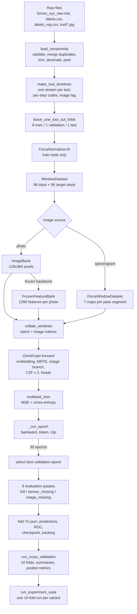
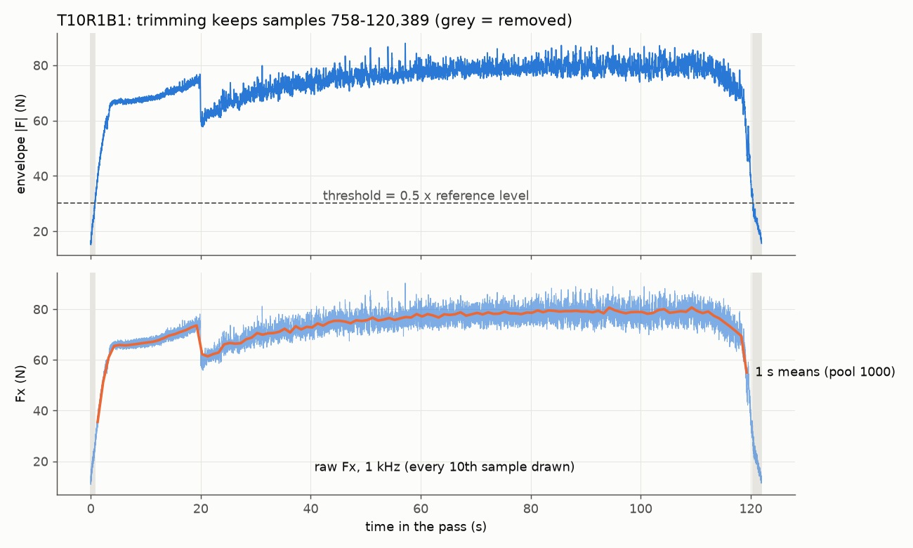
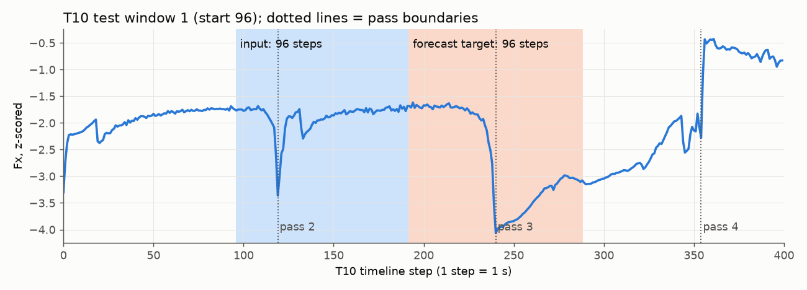
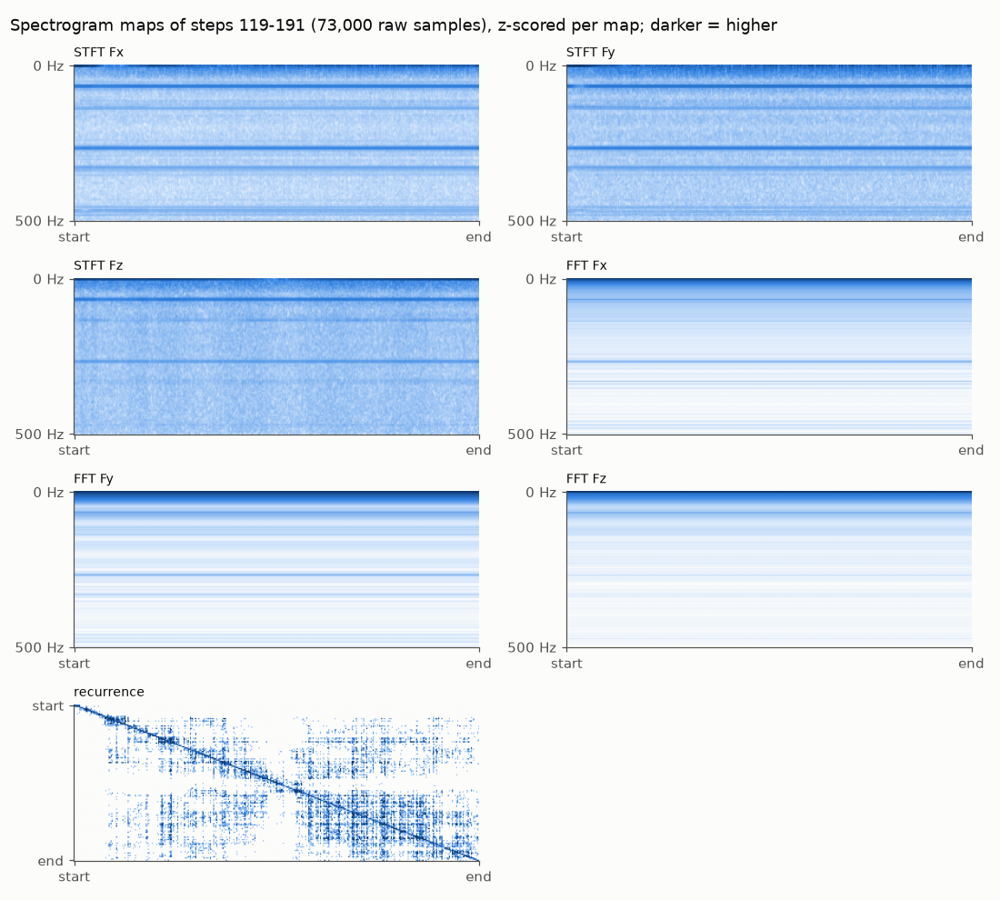
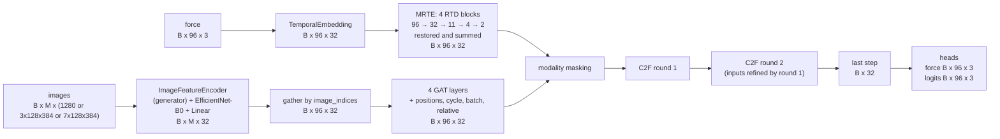
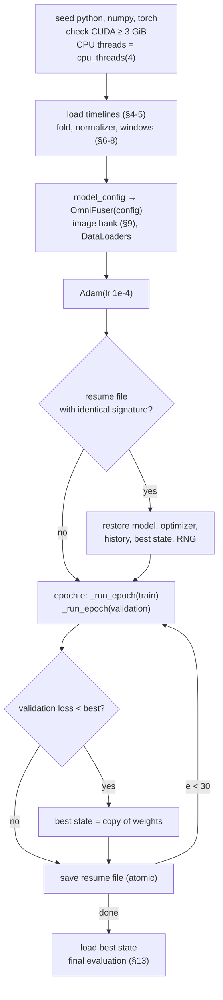

# End-to-end simulation of the OmniFuser pipeline

This document follows the data through the whole codebase, from the raw files
to the saved results: every function it passes through, with its input, its
processing (as equations) and its output, and real numbers at each step. All
variants and conditions are covered: duplicate handling, image lag, the three
image inputs (photos, cached frozen-photo features, spectrograms), the
ablations and architecture switches, and the evaluation modes.

**Where the numbers come from.** Every number below was measured on the real
Nonastreda data with the current code by
[`scripts/end_to_end_trace.py`](scripts/end_to_end_trace.py), which also draws
the figures in `docs/end_to_end/`. The running example is tool **T10**, its
first pass **T10R1B1**, and fold **T10** (test tool T10, validation tool T1).
The model shown is **untrained** (seed 42, eval mode), so its outputs show
shapes and scales, not results.

**Keep it current.** After any substantial change to preprocessing, the
model or the training loop, rerun the trace script and update this document
(§20).

Last verified: 2026-10-26, against the code after the image-GAT switch and
the saved-model files (146 tests).

---

## Contents

| § | Stage | Main code |
|---|---|---|
| 0 | Notation | |
| 1 | The pipeline at a glance | |
| 2 | Entry points: which command calls what | `omnifuser/cli.py`, `scripts/` |
| 3 | Raw files | `Nonastreda_Data/` |
| 4 | Loading, duplicates, trimming, pooling | `data.load_nonastreda` |
| 5 | Tool timelines and image lag | `data.make_tool_timelines` |
| 6 | Folds | `data.leave_one_tool_out_folds` |
| 7 | Force normalization | `data.ForceNormalizer` |
| 8 | Windows | `data.WindowDataset`, `train._limit_dataset` |
| 9 | Image inputs: photos, cached features, spectrograms; collation | `data.ImageBank`, `train.FrozenFeatureBank`, `spectrogram.py`, `data.collate_windows` |
| 10 | The model, block by block | `models.py` |
| 11 | The loss | `models.multitask_loss` |
| 12 | The training loop | `train.train_fold`, `train._run_epoch` |
| 13 | Final evaluation and metrics | `train.train_fold`, `evaluation.py` |
| 14 | 10-fold cross-validation | `cross_validation.run_cross_validation` |
| 15 | Experiment suites | `scripts/run_experiment_suite.py` |
| 16 | Tracking and saved files | `tracking.ExperimentTracker` |
| 17 | Every variant and where it acts | |
| 18 | Runtime safeguards | `resources.py`, `__init__.py` |
| 19 | Function map | |
| 20 | Keeping this document current | |

---

## 0. Notation

| Symbol | Meaning | Protocol value |
|---|---|---|
| $f_s$ | Force sampling rate | 1000 Hz (1 sample = 1 ms) |
| $q$ | Pool factor (`--pool`): raw samples per time step | 1000 (1 step = 1 s) |
| $C$ | Force channels $(F_x, F_y, F_z)$ | 3 |
| $T$ | Input steps per window (`--input-len`) | 96 |
| $P$ | Forecast steps (`--horizon`) | 96 |
| $s$ | Training-window stride (`--stride`); evaluation uses $\max(s,P)$ | 24 (evaluation 96) |
| $B$ | Batch size | 32 |
| $d$ | Model width (`--d-model`) | 32 |
| $L$ | RTD blocks in MRTE | 4 |
| $s_l$ | RTD kernel = stride | 3 |
| $r$ | RTD trend rank | 8 |
| $H$ | Attention heads (GAT and C2F) | 4 |
| $K$ | Landmarks | 4 |
| $n$ | C2F rounds | 2 |
| $M$ | Distinct images in one window | 1-3 |
| $\mathcal{K}=3$ | Classes: sharp (0), used (1), dulled (2) | |

Tensors are written with their shapes, e.g. $X\in\mathbb{R}^{B\times T\times C}$.
Forces are in newtons (N).

---

## 1. The pipeline at a glance



| Stage | Function | Input | Output |
|---|---|---|---|
| Load | `data.load_nonastreda` | data folder, flags | 378 `Record`s (or 512 with duplicates kept) |
| Timelines | `data.make_tool_timelines` | records, image lag | 10 `ToolTimeline`s |
| Folds | `data.leave_one_tool_out_folds` | tool names | 10 `ToolFold`s |
| Normalize | `data.ForceNormalizer.fit` | 8 training timelines | per-channel mean and scale |
| Windows | `data.WindowDataset` | timelines, normalizer, $T,P,s$ | indexable windows |
| Images | `data.ImageBank` / `train.FrozenFeatureBank` / `spectrogram.ForceWindowDataset` | photos / photos + frozen encoder / raw force | pixels / features / feature maps |
| Batch | `data.collate_windows` | list of windows | dict of batched tensors |
| Model | `models.OmniFuser.forward` | batch tensors | force forecast, class logits, diagnostics |
| Loss | `models.multitask_loss` | outputs, targets | scalar loss + components |
| Train | `train._run_epoch` inside `train.train_fold` | loaders, model, optimizer | epoch metrics |
| Evaluate | `train._run_epoch` + `evaluation.*` | selected model | metrics, predictions, ROC curves |
| Cross-validate | `cross_validation.run_cross_validation` | settings | 10 folds + summaries |
| Study | `scripts/run_experiment_suite.py` | study name | one 10-fold run per variant |

---

## 2. Entry points: which command calls what

| Command | Call chain | Used for |
|---|---|---|
| `omnifuser inspect` | `cli.main` → `cli._inspect` → `load_nonastreda`, `make_tool_timelines` | Data report (JSON) without training |
| `omnifuser train` | `cli.main` → `cli._train` → `train.train_fold` | One fold (smoke test, pilot) |
| `omnifuser export` | `cli._export` → `model_bundle.export_model` | Copy one fold's trained model to a portable file |
| `omnifuser predict` | `cli._predict` → `model_bundle.predict` → `load_model`, `train.load_timelines`, `window_dataset`, `image_bank_for`, `_run_epoch` | Forecast a tool with a saved model, without training |
| `scripts/train_lightning.py` | `main` → `cross_validation.run_cross_validation` → `train.train_fold` × 10 | Full 10-fold run (steps 3a, 3b, single runs) |
| `scripts/run_experiment_suite.py` | `main` → `run_cross_validation` per variant | Studies (ablations, sensitivity, ...) |
| `scripts/train_local.py` | `main` → `train.train_fold` | Local CPU smoke test (2/1 windows) |
| `scripts/compare_with_paper.py` | `load_folds` → `aggregate` → `render` | Paper-style horizon table from fold JSONs |
| `scripts/model_summary.py` | builds `OmniFuser`, counts parameters | Shapes and parameter check |
| `scripts/eda.py` | `load_nonastreda`, `make_tool_timelines`, ... | The data analysis behind `EDA.md` |
| `scripts/end_to_end_trace.py` | the whole pipeline on one fold, untrained | The numbers and figures of this document |
| `slurm/job.sbatch` | sets `OMP_NUM_THREADS`, then runs any of the above | Ruche jobs |

All training entry points share `cli.add_protocol_arguments` and
`cli.protocol_kwargs`, so every flag reaches `train_fold` the same way.

---

## 3. Raw files

| File | Contents | Real values |
|---|---|---|
| `forces_xyz_raw.mat` | MATLAB table `baseDatastore`: per row a file name, a label, a tool label and a force array of shape $(3, n)$ | 512 rows, $n$ ≈ 52,000-153,000 samples |
| `labels.csv` | `id,image_label,tool_label` | 512 rows, e.g. `T1R2B1,sharp,1` |
| `labels_reg.csv` | `id,gaps,flank_wear,overhang` | flank wear decides which duplicate is kept |
| `tool/*.jpg` | one photo per pass, named like the record | 512 photos, 1550 × 500 pixels |

A record ID `TtRrBb` encodes the tool $t$, the run $r$ (a cycle of passes)
and the block $b$ (pass 1-4 inside the run). `data.RECORD_ID` parses it, and
`data._decode_record_id` returns `("T10", 1, 1, "T10R1B1")`.

---

## 4. Loading, duplicates, trimming, pooling

**Function:** `omnifuser/data.py: load_nonastreda(data_dir, label_column, decimation, dedup_identical_forces, trim_pass, pool)`

**Input:** the data folder and five flags. **Output:** a list of `Record`s
sorted by (tool, run, block). Each holds `record_id`, `tool`, `run`,
`block`, `force` (an array of shape $(n',3)$), `label` and `image_path`, plus
bookkeeping (`source_length_samples`, `trimmed_lead_samples`,
`trimmed_runout_samples`, `pool_dropped_samples`).

The steps run in this order for every pass.

### 4.1 Validation and labels

1. `labels.csv` and `labels_reg.csv` must have the same IDs, and every
   `flank_wear` must be a finite number.
2. The MAT IDs must equal the CSV IDs. Each force array must have shape
   $(3,n)$ and contain only finite values; each photo must exist.
3. **Label.** With `--label-column image_label` (default) the CSV label must
   equal the MAT label and maps `sharp→0, used→1, dulled→2`. With
   `tool_label` the value 1-3 becomes 0-2.

### 4.2 Duplicate merging (`--dedup-identical-forces`, default True)

Within each (tool, run), passes whose force arrays are **bit-identical** form
a group. In each group with two or more members the code keeps

$$
\text{kept} = \arg\max_{i\in\text{group}} \big(\text{flank\_wear}_i,\; -\text{block}_i\big),
$$

the most-worn pass, with ties going to the earliest block, and discards the
others. On the real data this removes 134 copies in 132 groups (`EDA.md` §3):

| | Passes | sharp / used / dulled |
|---|---|---|
| `True` (protocol) | 378 | 147 / 118 / 113 |
| `False` | 512 | 197 / 160 / 155 |

T10's first run shows it: its passes are T10R1B1, T10R1B2, **T10R1B4**.
T10R1B3 was a copy of B4 and B4 is the more worn, so B3 was dropped. The
MATLAB copy of each array is released as soon as it is converted, which
keeps the peak memory of unpooled loads near 1.4 GB.

### 4.3 Pass trimming (`--trim-pass`, default on)

**Function:** `data._nonastreda_span_bounds(force)` → `(start, end)`.

A pass starts and ends with low-force tool entry and exit. The rule keeps the
span where a smoothed force magnitude stays above half of the early cutting
level:

$$
m_t=\sum_{c=1}^{3}x_{t,c}^2,\qquad
e_t=\sqrt{\tfrac{1}{20}\textstyle\sum_{\tau=t-10}^{t+9} m_\tau}\quad(\text{uniform filter, 20 samples}),
$$

$$
R=\max\big(20,\lfloor 0.05\,n\rfloor\big),\qquad
\rho=\operatorname{median}(e_0,\dots,e_{R-1}),\qquad
\mathcal{A}=\{t: e_t\ge 0.5\,\rho\},
$$

$$
\text{start}=\min\mathcal{A},\qquad \text{end}=\max\mathcal{A}+1,\qquad x\leftarrow x_{\text{start}:\text{end}}.
$$

**Example, T10R1B1:**

| Quantity | Value |
|---|---|
| Raw samples $n$ | 121,960 (122.0 s) |
| First raw sample $(F_x,F_y,F_z)$ | (14.04, 9.00, −3.97) N |
| Reference length $R=\lfloor 0.05\cdot 121{,}960\rfloor$ | 6,098 samples |
| Reference level $\rho$ | 60.46 N |
| Threshold $0.5\rho$ | 30.23 N |
| Kept span | samples 758 to 120,389 |
| Removed lead / run-out | 758 / 1,571 samples |
| Kept samples | 119,631 |



*Figure 1. Top: the envelope $e_t$ and the threshold; grey spans are
removed. Bottom: the raw $F_x$ at 1 kHz and its 1 s means after pooling.*

Over all 378 passes, trimming removes 179,437 lead and 414,078 run-out
samples (1.6 % of 37.7 M).

### 4.4 Decimation (`--decimation N`, default 1 = off)

With $N>1$, `scipy.signal.decimate` applies a zero-phase anti-aliasing filter
and keeps every $N$-th sample, before pooling. The protocol never uses it.

### 4.5 Pooling (`--pool q`, protocol 1000)

**Function:** `data._block_mean(force, q)` (also `data.pool_records` for the
spectrogram path, which loads unpooled first).

$$
\bar{x}_k=\frac{1}{q}\sum_{j=0}^{q-1}x_{kq+j},\qquad k=0,\dots,\Big\lfloor \tfrac{n'}{q}\Big\rfloor-1,
$$

computed in float64, stored as float32. The incomplete last block is dropped
(`pool_dropped_samples`). Each pass is pooled on its own, so no step mixes
two passes.

**Example, T10R1B1:** 119,631 kept samples → 119 steps; 631 samples dropped.
The first step is the mean of samples 758-1,757:
$\bar{x}_0=(35.52,\,14.71,\,-6.37)$ N.

Pooling removes every force component faster than 0.5 Hz. The spectrogram
image source (§9.3) is where that content can return.

**Output over the dataset:** 378 passes of 50-149 steps (median 96).

---

## 5. Tool timelines and image lag

**Function:** `data.make_tool_timelines(records, image_lag)` → `list[ToolTimeline]`.

**Input:** pooled records and `--image-lag` (0 or 1). **Process:** each tool's
passes, sorted by (run, block), are concatenated into one stream. Every step
$t$ gets:

| Field | Shape | Value at step $t$ in pass $p$ (pass length $L_p$, position $u$ inside it) |
|---|---|---|
| `force` | $(N_{\text{tool}},3)$ | the pooled force |
| `labels` | $(N_{\text{tool}},)$ | the pass label (the forecast target) |
| `image_codes` | $(N_{\text{tool}},)$ | index into `image_paths` of the image shown at $t$ |
| `image_labels` | $(N_{\text{tool}},)$ | label of the pass whose image is shown (−1 for none) |
| `cycle_codes` | $(N_{\text{tool}},)$ | the run number |
| `batch_codes` | $(N_{\text{tool}},)$ | the block number |
| `relative_codes` | $(N_{\text{tool}},)$ | $\min(\lfloor 16u/L_p\rfloor, 15)$: position in the pass, 16 bins |

**Image lag.** With lag 0 (protocol, paper) step $t$ shows its own pass's
photo. With lag 1 it shows the previous pass's photo. A tool's first pass has
no previous pass, so its steps show `NO_IMAGE`: a blank image with label −1.

**Example, T10** (42 passes, 5,081 steps; passes end at steps 119, 240, 354, 471, …):

| Step $t$ | Pass | image code (lag 0) | label | cycle | batch | relative |
|---|---|---|---|---|---|---|
| 0 | T10R1B1 | 0 | 0 | 1 | 1 | 0 |
| 7 | T10R1B1 | 0 | 0 | 1 | 1 | 0 ($\lfloor 16\cdot7/119\rfloor=0$) |
| 8 | T10R1B1 | 0 | 0 | 1 | 1 | 1 ($\lfloor 128/119\rfloor=1$) |
| 118 | T10R1B1 | 0 | 0 | 1 | 1 | 15 |
| 119 | T10R1B2 | 1 | 0 | 1 | 2 | 0 |

With lag 1, `image_paths` starts `["<no previous image>", ".../T10R1B1.jpg"]`
and `image_labels` is −1 at step 0 and 0 (sharp) at step 119.

**Totals:** 36,903 steps over the 10 tools (T1 2,793 … T10 5,081).

---

## 6. Folds

**Function:** `data.leave_one_tool_out_folds(tools)` → 10 `ToolFold(train_tools, validation_tools, test_tools)`.

For tool $i$ in T1…T10: test $=i$, validation = the next tool (cyclic), train
= the other 8.

| Test | Validation | Train |
|---|---|---|
| T1 | T2 | T3-T10 |
| T2 | T3 | T1, T4-T10 |
| … | … | … |
| T9 | T10 | T1-T8 |
| T10 | T1 | T2-T9 |

No tool ever appears in two roles within a fold, so no pass, photo or
normalization statistic of the validation or test tool reaches training.

---

## 7. Force normalization

**Function:** `data.ForceNormalizer.fit(train_timelines)`; `transform(values)`.

**Input:** the 8 training timelines only. **Process:** per-channel mean and
standard deviation over all their steps, merged timeline by timeline with the
parallel-variance formula (Chan et al.):

$$
\mu\leftarrow\mu+\delta\frac{n_b}{n_a+n_b},\qquad
M_2\leftarrow M_2+M_{2,b}+\delta^2\frac{n_a n_b}{n_a+n_b},\qquad
\sigma=\sqrt{M_2/N},\quad\delta=\mu_b-\mu.
$$

A $\sigma<10^{-8}$ becomes 1. **Transform:** $z=(x-\mu)/\sigma$, applied to
inputs and targets of every split.

**Example, fold T10** (train T2-T9):

| | $F_x$ | $F_y$ | $F_z$ |
|---|---|---|---|
| $\mu$ (N) | 127.66 | −12.02 | −16.54 |
| $\sigma$ (N) | 27.90 | 14.05 | 19.37 |

T10 step 96 has $x=(78.40,\,3.92,\,-7.81)$ N, so
$z=\big(\tfrac{78.40-127.66}{27.90},\tfrac{3.92+12.02}{14.05},\tfrac{-7.81+16.54}{19.37}\big)=(-1.766,\,1.135,\,0.451)$.

---

## 8. Windows

**Function:** `data.WindowDataset(timelines, normalizer, T, P, stride)`;
`locate(index)` → (timeline, start); `__getitem__(index)` → dict.

**Count.** A timeline of $N$ steps gives

$$
W=\max\!\Big(\Big\lfloor\frac{N-T-P}{s}\Big\rfloor+1,\;0\Big)
$$

windows. Window $w$ starts at $a=ws$: input steps $[a,a+T)$, target steps
$[a+T,a+T+P)$. Windows never cross tools.

| Example | $N$ | $s$ | $W$ |
|---|---|---|---|
| T10, training stride | 5,081 | 24 | $\lfloor 4889/24\rfloor+1=204$ |
| T10, evaluation stride | 5,081 | 96 | $\lfloor 4889/96\rfloor+1=51$ |
| T1, evaluation stride | 2,793 | 96 | $\lfloor 2601/96\rfloor+1=28$ |
| All tools, stride 24 | 36,903 | 24 | 1,462 |

**Fold T10:** 1,149 training windows (T2-T9, stride 24), 28 validation (T1),
51 test (T10). Over the 10 folds the training count ranges from 1,127 to
1,213. The evaluation stride $\max(s,P)=96$ makes consecutive targets
non-overlapping, so every test step is scored once.

**One item** (`__getitem__`):

| Key | Shape | Content |
|---|---|---|
| `force` | $(T,3)$ | $z$-scored input |
| `force_target` | $(P,3)$ | $z$-scored future force |
| `class_target` | $(P,)$ | future labels |
| `shown_label` | scalar | `image_labels[a+T-1]`: label of the image shown at the last input step (for the persistence baseline) |
| `image_paths` | $T$ paths | the image shown at each input step |
| `cycle`, `batch`, `relative` | $(T,)$ each | the step codes |

**Example: T10 test window 1** (start 96): input steps 96-191, targets
192-287. Its input crosses the boundary at step 119, so it shows two photos:
T10R1B1 for 23 steps and T10R1B2 for 73. All 96 targets are class 0, and
`shown_label` is 0. Window 0 (steps 0-95) lies inside the first pass and
shows one photo.



*Figure 2. Pooled, z-scored $F_x$ of T10. Blue: the 96 input steps; orange:
the 96 forecast targets; dotted: pass boundaries.*

**Caps** (`train._limit_dataset`): `--max-train-windows` / `--max-eval-windows`
keep a reproducible random subset (`random.Random(seed)`, seed+1, seed+2).
They are for smoke tests only.

---

## 9. Image inputs and collation

Three image sources reach the model. Which one is used depends on
`--image-source` and `--freeze-image-encoder`:

| Source | Condition | What one image is | Shape per image |
|---|---|---|---|
| Photo pixels | `photo`, backbone trains | the pass photo, resized and normalized | $(3,128,384)$ |
| Cached photo features | `photo`, `--pretrained --freeze-image-encoder` (**protocol**) | the frozen EfficientNet-B0 features of that photo | $(1280,)$ |
| Spectrogram maps | `spectrogram` (experiment) | 7 feature maps of the raw force of one pass segment of the window | $(7,128,384)$ |

### 9.1 Photos

**Functions:** `data.ImageBank(paths, 128, 384)`; `ImageBank.tensor(path)`.

Each photo is decoded once per fold, converted to RGB, resized with PIL
bilinear interpolation from 1550 × 500 to 384 × 128, and cached as uint8.
The 378 photos take 53.2 MB. `tensor(path)` returns

$$
\tilde{I}_{c,h,w}=\frac{I_{c,h,w}/255-m_c}{\sigma_c},\quad m=(0.485,0.456,0.406),\;\sigma=(0.229,0.224,0.225)
$$

(the ImageNet statistics, in every run). Example: the top-left pixel of
T10R1B1 is RGB (127, 139, 137) → $(0.057,\,0.398,\,0.583)$. `NO_IMAGE`
returns zeros.

### 9.2 Cached frozen features (the protocol)

**Class:** `train.FrozenFeatureBank(bank, encoder, device)`; `tensor(path)`.

With `--freeze-image-encoder`, EfficientNet-B0's weights are fixed and the
trunk always runs in eval mode. That keeps BatchNorm statistics fixed and
turns off stochastic depth, so a photo's features are a fixed function of the
photo. The bank computes them once per fold:

$$
\phi(I)=\operatorname{AvgPool}\big(\mathrm{EffNetB0}_{\text{features}}(\tilde I)\big)\in\mathbb{R}^{1280}.
$$

It covers the 378 photos plus the blank image, 379 vectors in 9.2 s on a
laptop CPU. The model then receives $(B,M,1280)$ features instead of
$(B,M,3,128,384)$ pixels. The outputs match per-batch computation up to float
rounding (tested to $10^{-5}$), but training
is about 4× faster per step on CPU (417 → 108 ms, batch 8). Example: T10R1B1's
vector has mean 0.064, std 0.390, range −0.25 to 3.04. The blank image's
vector is not zero (mean −0.154): it is what the backbone makes of a
mean-gray input.

### 9.3 Spectrograms (experiment, `--image-source spectrogram`)

**Functions:** `spectrogram.raw_passes_by_tool(raw_records, q)`;
`spectrogram.ForceWindowDataset` (a `WindowDataset`); `segments(i, a)`;
`force_window_image(force, settings, 128, 384)`.

Only VLT's time-to-image construction (arXiv:2607.14510, Eqs. 5-8) is used;
everything after it is OmniFuser. Spectrogram runs load the data unpooled
($q=1$), keep each pass's raw samples (`raw_passes_by_tool`, cut to
$\lfloor n'/q\rfloor q$ so they align exactly with the pooled steps), then
pool.

**Segments.** A window's input $[a,a+T)$ is split at pass boundaries. Each
pass segment covering steps $[u,v)$ supplies its raw samples
$x\in\mathbb{R}^{(v-u)q\times 3}$, and nothing outside the input. Example,
T10 test window 1:

| Segment | Pass | Steps | Raw samples | STFT frames $\lfloor(n-256)/64\rfloor+1$ |
|---|---|---|---|---|
| 0 | T10R1B1 | 96-118 | 23,000 | 356 |
| 1 | T10R1B2 | 119-191 | 73,000 | 1,137 |

A window inside one pass has a single 96,000-sample segment (1,497 frames).

**The 7 maps** (`force_window_image`). With $\tilde{x}_c = x_c-\operatorname{mean}(x_c)$
(the static force is already in the sensor branch), zero-padded to 256
samples if shorter, window $w$ = Hann(256), hop $h=64$:

1. **Time-frequency** (channels 0-2, VLT's wavelet map as a fixed-window STFT):

   $$X_c[k,m]=\sum_{t=0}^{255}\tilde{x}_c[mh+t]\,w[t]\,e^{-j2\pi kt/256},\qquad
   S_c=\log_{10}\!\big(|X_c|^2+10^{-12}\big)\in\mathbb{R}^{129\times F},$$

   resized (bilinear, antialiased) to $128\times384$. Rows are frequency, 0 Hz
   at the top, 3.9 Hz per row up to 500 Hz; columns are time. Segment 1's
   1,137 frames become 384 columns of about 0.19 s each.
2. **Global spectrum** (channels 3-5, VLT Eq. 6):

   $$A_c[f]=\log_{10}\!\Big(\Big|\sum_{t}\tilde{x}_c[t]e^{-j2\pi ft/n}\Big|^2+10^{-12}\Big),$$

   averaged into the same 128 frequency rows (segment 1: 36,501 bins, about 285
   per row) and repeated along the 384 columns. A pixel thus holds the local
   power and the segment's mean power at the same frequency.
3. **Recurrence** (channel 6, VLT Eq. 5) between the 384 spectral columns
   $v_j\in\mathbb{R}^{3\cdot128}$ of channels 0-2:

   $$D_{ij}=\lVert v_i-v_j\rVert_2,\qquad \varepsilon=Q_{0.1}(D),\qquad R_{ij}=\mathbb{1}[D_{ij}\le\varepsilon],$$

   so 10 % of the 147,456 pairs recur (`--spectrogram-recurrence-rate`). The
   $384\times384$ map is averaged down to $128\times384$.

Each map is then standardized on its own: $M\leftarrow (M-\operatorname{mean}M)/\max(\operatorname{std}M,10^{-6})$.
No statistic crosses windows or tools. Building window 1's two images took
0.07 s on a laptop CPU.



*Figure 3. The 7 maps of T10 steps 119-191. The STFT and FFT maps share their
frequency rows; the recurrence map shows which moments have similar spectra.*

**No leakage.** An image uses only the raw samples of its window's input
steps, which the sensor branch already sees as 1 s means. That is why
spectrogram runs use image lag 0, and `train_fold` refuses lag 1 with them.
Every window has an image.

**Item.** `ForceWindowDataset.__getitem__` drops `image_paths` and adds
`images` $(M,7,128,384)$ and `image_index` $(T,)$, the segment index of each
step. For window 1: `image_index` is 0 for 23 steps, then 1.

### 9.4 Collation

**Function:** `data.collate_windows(samples, height, width, bank)` → batch dict.

For photos (`_photo_batch`), each window's distinct paths are listed in
first-seen order. Each step stores the position of its path in that list, and
the images come from the bank: pixels, or features when the bank is a
`FrozenFeatureBank`. Spectrogram windows carry their images already. Windows
with fewer images are padded with their first image, which no step points
to.

Example batch of T10 test windows 0 and 1 (cached features):

```text
window 0: steps 0-95,   1 photo  -> images[0] = [phi(T10R1B1), phi(T10R1B1) (pad)]
                                    image_indices[0] = [0, 0, ..., 0]
window 1: steps 96-191, 2 photos -> images[1] = [phi(T10R1B1), phi(T10R1B2)]
                                    image_indices[1] = [0]*23 + [1]*73
```

| Batch key | Shape (this example) | Protocol batch |
|---|---|---|
| `force`, `force_target` | $(2,96,3)$ | $(32,96,3)$ |
| `class_target` | $(2,96)$ | $(32,96)$ |
| `cycle`, `batch`, `relative`, `image_indices` | $(2,96)$ | $(32,96)$ |
| `shown_label` | $(2,)$ | $(32,)$ |
| `images` | $(2,2,1280)$ | $(32,M_{\max},1280)$; pixels $(32,M_{\max},3,128,384)$; spectrograms $(32,M_{\max},7,128,384)$ |

---

## 10. The model, block by block

**Class:** `models.OmniFuser(config)`; `forward(force, images, image_indices, cycle, batch_code, relative, drop_modality)`.
The configuration is `config.ModelConfig`, built by `train.model_config`.



### 10.1 Temporal embedding (paper Eq. 1)

**Class:** `models.TemporalEmbedding`. **Input:** $Z_0\in\mathbb{R}^{B\times T\times 3}$ and the step codes. **Output:** $E\in\mathbb{R}^{B\times T\times d}$.

$$
E=\operatorname{Dropout}_{0.1}\Big(W_2\,\mathrm{GELU}(W_1 z_t+b_1)+b_2\;+\;\mathrm{PE}_t\;+\;e^{\text{cyc}}_{c_t}+e^{\text{blk}}_{b_t}+e^{\text{rel}}_{p_t}\Big),
$$

$$
\mathrm{PE}_{t,2i}=\sin\!\big(t/10000^{2i/d}\big),\qquad \mathrm{PE}_{t,2i+1}=\cos\!\big(t/10000^{2i/d}\big).
$$

The code tables have 128 (run), 8 (block) and 16 (position) rows, and codes
are clipped to the table size. Parameters: value MLP 1,184 + tables 4,864 =
**6,048**. Example batch: $E$ has mean 0.37 and std 1.80.

### 10.2 MRTE: four RTD blocks (paper Eqs. 2-3)

**Classes:** `models.MultiResolutionTemporalExtractor`, `models.RTDBlock`.
**Input:** $E$. **Output:** $Z^r=\sum_{l=1}^{L}\tilde U^{(l)}\in\mathbb{R}^{B\times T\times d}$.

Block $l$ takes $D^{(l-1)}\in\mathbb{R}^{B\times T_{l-1}\times d}$ (with $D^{(0)}=E$, $T_0=T$):

1. **Downsample:** pad the time axis on the right to a multiple of $s_l$, apply
   a depthwise convolution with kernel = stride = $s_l$ (no bias), then a
   channel mix: $D^{(l)}=\mathrm{Mix}\big(\mathrm{DWConv}_{s_l}(D^{(l-1)})\big)$, $T_l=\lceil T_{l-1}/s_l\rceil$.
2. **Decompose:** trend $\Theta=D^{(l)}W_LW_R$ (low rank $d\to r\to d$),
   seasonal $\Sigma=D^{(l)}-\Theta$.
3. **Combine** (`--decomp-mode branch`, default): $U=\mathrm{FFN}_\Theta(\Theta)+\mathrm{FFN}_\Sigma(\Sigma)$.
   The printed Eq. 3 (`literal`) gives $U=\Theta+\Sigma=D^{(l)}$.
4. **Restore:** a linear map over time $T_l\to T$, then $\tilde U^{(l)}=\mathrm{FFN}_{\text{ch}}(\mathrm{GELU}(\cdot))$.

$D^{(l)}$ feeds the next block, and the restored $\tilde U^{(l)}$ are summed.
The embedding itself is not added back.

| Block | $T_{l-1}$ | pad | $T_l$ | time-restore params | block params |
|---|---|---|---|---|---|
| 1 | 96 | 0 | 32 | 3,168 | 15,296 |
| 2 | 32 | 1 | 11 | 1,152 | 13,280 |
| 3 | 11 | 1 | 4 | 480 | 12,608 |
| 4 | 4 | 2 | 2 | 288 | 12,416 |
| **MRTE** | | | | | **53,600** |

Each block has 12,128 parameters besides its time-restore layer. Example
batch: $Z^r$ has mean −0.008 and std 0.159, much smaller than $E$, because
the restored components start small at initialization.

**Variants:** `--ablation moving_average` replaces $W_LW_R$ by a 3-step moving
average. `without_mrte` and `without_rr_mrte` replace MRTE by the identity
($Z^r=E$). `--rtd-layers`, `--rtd-stride` and `--rtd-rank` change $L$, $s_l$ and $r$.

### 10.3 Image branch (paper Eq. 4 and Sec. V-B)

**Classes:** `models.ImageFeatureEncoder`, `models.ImageBranch`, `models.GraphAttentionLayer`.

1. **Encode** each of the $M$ images (`ImageFeatureEncoder.forward`):
   - precomputed features $(B,M,1280)$ (protocol): only the projection, $\mathbb{R}^{1280}\to\mathbb{R}^{32}$;
   - pixels $(B,M,3,128,384)$: EfficientNet-B0 trunk, average pool, projection;
   - spectrogram maps $(B,M,7,128,384)$: first the **image generator**
     (VLT Eq. 8; Conv 7→16 3×3, GELU, Conv 16→3 1×1; 1,075 parameters, always
     trained), then as pixels.
   - `compact` encoder: a 3-layer CNN with 96 features, for CPU tests.

   Output: $(B,M,32)$. Parameters: trunk 4,007,548 (frozen in the protocol) +
   projection 40,992.
2. **Place:** gather the image vector of each step,
   $V_t=\mathrm{enc}_{\,\text{image\_indices}[t]}$, giving $(B,T,d)$. This equals
   the paper's "replicate each image across the steps of its pass".
3. **Temporal GAT**, 4 layers, $H=4$ heads of width 8 over a fully connected
   graph of the $T$ steps:

   $$h=W V,\quad \alpha^{(h)}_{ij}=\operatorname{softmax}_j\Big(\mathrm{LeakyReLU}_{0.2}\big(a_s^{(h)\top}h^{(h)}_i+a_t^{(h)\top}h^{(h)}_j\big)\Big),\quad
   \mathrm{GAT}(V)_i=\Big\Vert_h\sum_j\alpha^{(h)}_{ij}h^{(h)}_j,$$

   $$V\leftarrow\mathrm{LayerNorm}\big(V+\mathrm{Dropout}(\mathrm{ELU}(\mathrm{GAT}(V)))\big).$$
4. **Add** position encoding and the branch's own run/block/position tables:
   $Z^i=V+\mathrm{PE}+e^{\text{cyc}}+e^{\text{blk}}+e^{\text{rel}}$.

Parameters after the encoder: 4 × 1,152 (GAT + LayerNorm) + 4,864 (tables) =
**9,472**. Example: the encoder output is $(2,2,32)$; $Z^i$ has mean 0.54
and std 2.19.

**Variant:** `--no-image-gat` (`ModelConfig.image_gat=False`; an experiment,
step 7's `pretrained-frozen-no-gat` arm) builds no GAT layers. Step 3 is then
skipped, and $Z^i=V+\mathrm{PE}+e^{\text{cyc}}+e^{\text{blk}}+e^{\text{rel}}$
with $V$ the gathered, projected encoder features (4,608 fewer parameters).
`fold-Tn.json` records `"image_gat_layers": 0`.

### 10.4 Modality masking

**Method:** `OmniFuser._mask_modalities(sensor, image, drop_modality)`, applied to $Z^r$ and $Z^i$ before fusion.

- **Evaluation modes:** `drop_modality="sensor"` sets $Z^r=0$;
  `"image"` sets $Z^i=0$. These produce the `sensor_missing` and
  `image_missing` evaluations (§13).
- **Training dropout** (`--modality-dropout p`, protocol 0): per window draw
  $u\sim\mathcal{U}(0,1)$. If $u<p/2$ the sensor stream is zeroed; if
  $p/2\le u<p$ the image stream is zeroed; otherwise both stay. With $p=0.2$:
  10 % of windows lose the force, 10 % the image, and never both.

### 10.5 C2F fusion layer (paper Eqs. 5-20)

**Class:** `models.CrossModalFusionLayer`. **Input:** $Z^r, Z^i\in\mathbb{R}^{B\times T\times d}$.
**Output:** fused $F\in\mathbb{R}^{B\times T\times d}$, plus the alignment and orthogonality diagnostics.

For each stream $m\in\{r,i\}$ (separate weights per stream):

1. *(Optional, `--pre-attn`)* $Z^m\leftarrow\mathrm{LN}(Z^m+\mathrm{MHA}(Z^m))$.
2. **Shared/private split** (`_decompose`, Eq. 5): $S^m=Z^mW'_m$ and

   $$c^m=\frac{\langle Z^m,S^m\rangle_F}{\lVert S^m\rVert_F^2},\qquad P^m=Z^m-c^mS^m.$$

   The shared part passed on is $S^m$ (default) or $c^mS^m$ (`--exact-split`,
   so that $Z^m=P^m+c^mS^m$ exactly).
3. **Private path:** $\hat P^m=\mathrm{MHA}(P^m)$ (`--private-attn plain`,
   default) or $\mathrm{LN}(P^m+\mathrm{MHA}(P^m))$ (`residual_ln`).
4. **Adaptive landmarks** (ALS, Eqs. 9-11): scores $A^m=S^mW^{\text{score}}_m\in\mathbb{R}^{T\times K}$.
   With `--als-mode k_colnorm` (default) take the softmax over the $K$
   landmarks for each step, then normalize each landmark's weights over time:

   $$\omega_{tk}=\frac{\operatorname{softmax}_k(A_t)_k}{\sum_{t'}\operatorname{softmax}_k(A_{t'})_k},\qquad
   \Lambda^m=\omega^\top S^m\in\mathbb{R}^{K\times d},\qquad \Lambda^m_V=\omega^\top(S^mW^V_m).$$

   `k_sum` skips the normalization over time (the printed sums). `time` takes
   the softmax over time. `--ablation without_als` uses the means of $K$
   contiguous time segments.
5. **Cross-modal attention:** each stream's shared part queries the other
   stream's landmarks:

   $$X^r=\operatorname{softmax}\!\Big(\frac{S^r\Lambda^{i\top}}{\sqrt d}\Big)\Lambda^i_V,\qquad
   X^i=\operatorname{softmax}\!\Big(\frac{S^i\Lambda^{r\top}}{\sqrt d}\Big)\Lambda^r_V.$$
6. **Hybrid gate** (Eqs. 16-19), with $Q^m=[X^m;\hat P^m]\in\mathbb{R}^{T\times 2d}$:

   $$g^m=\sigma(\mu_m)\,\sigma(W^g_mQ^m)+\big(1-\sigma(\mu_m)\big)\,\sigma\big(W^\ell_m\,\mathrm{DWConv}_3(Q^m)\big),\qquad
   \Phi^m=g^m\odot X^m+(1-g^m)\odot\hat P^m.$$

   $\mu_m$ starts at 0, so the global and local gates start at a 0.5
   mixture (example batch: $\sigma(\mu_r)=0.5$). `--ablation without_hybrid_gate`
   uses $\Phi^m=\tfrac12(X^m+\hat P^m)$.
7. **Low-rank projection** (Eq. 20): $F=\mathrm{Dropout}\big(W_b\,\mathrm{GELU}(W_a[\Phi^r;\Phi^i])\big)$, with $2d\to8\to d$.
8. **Diagnostics** (logged, not optimized):

   $$\mathcal{L}_{\text{align}}=\operatorname{mean}_{b,t,k}\Big(\tfrac{S^r_{bt}}{\lVert S^r_{bt}\rVert}-\tfrac{S^i_{bt}}{\lVert S^i_{bt}\rVert}\Big)_k^2,\qquad
   \mathcal{L}_{\perp}=\operatorname{mean}_b\big(\langle S^r,P^r\rangle_F^2+\langle S^i,P^i\rangle_F^2\big).$$

   (each step's shared vector is normalized on its own). $\mathcal{L}_\perp$ is **0 by construction**: $\langle S,Z-cS\rangle=\langle S,Z\rangle-c\lVert S\rVert^2=0$,
   and the same holds with `--exact-split`. The example batch logs exactly
   0.0, and alignment 0.052.

**Parameters per C2F layer (22,442):**

| Part | Parameters |
|---|---|
| Shared projections $W'_r,W'_i$ | 2,048 |
| Landmark scorers | 256 |
| Landmark value projections | 2,048 |
| Private MHA × 2 | 8,448 |
| Global gates × 2 | 4,160 |
| Local depthwise convs × 2 | 512 |
| Local gates × 2 | 4,160 |
| Gate mixes | 2 |
| Low-rank projection | 808 |

### 10.6 Recursive refinement (two rounds)

**In** `OmniFuser.forward`. Round 1 fuses the masked streams. Round 2 fuses
refined inputs:

$$
F^{(1)}=\mathrm{C2F}_1(Z^r,Z^i),\qquad
F^{(2)}=\mathrm{C2F}_2\big(Z^r+R_rF^{(1)},\;Z^i+R_iF^{(1)}\big),
$$

with bias-free $d\times d$ maps $R_r,R_i$ (2,048 parameters). The reported
alignment and orthogonality are the means over rounds.

| Variant | What runs |
|---|---|
| default | 2 separate C2F layers (`--fusion-layers` changes $n$) |
| `--share-c2f` | one C2F layer used in every round |
| `--ablation without_rr`, `without_rr_mrte` | 1 round |
| `--ablation concat_c2f` | each round is $\mathrm{Linear}([Z^r;Z^i])$ |
| `--ablation without_c2f` | $F=\tfrac12(Z^r+Z^i)$, no fusion layer |

### 10.7 Prediction heads (paper Eqs. 21-23)

Only the **last step** of the fused sequence is used: $f=F^{(n)}_{:,T-1}\in\mathbb{R}^{B\times d}$.

| `--prediction-head` | Force forecast $\hat Y\in\mathbb{R}^{B\times P\times 3}$ | Class logits $\in\mathbb{R}^{B\times P\times3}$ | Params |
|---|---|---|---|
| `direct` (protocol) | $\mathrm{reshape}(W_ff+b_f)$, $W_f\in\mathbb{R}^{288\times32}$ | same with its own weights | 19,008 |
| `paper_literal` | one step $W_ff+b$, repeated $P$ times | same | 198 |
| `lead_conditioned` | $\mathrm{GELU}(W[f;e_j])$ for each lead $j$ (learned lead embedding $e_j$), then $W_f$ | same | 5,350 |

### 10.8 Parameter budget

| Block | Parameters | Trains in the protocol |
|---|---|---|
| Temporal embedding | 6,048 | yes |
| MRTE | 53,600 | yes |
| EfficientNet-B0 trunk | 4,007,548 | **no** (frozen) |
| Image projection | 40,992 | yes |
| Image GAT + tables | 9,472 | yes |
| C2F rounds 1 and 2 | 2 × 22,442 | yes |
| Refinement maps | 2,048 | yes |
| Direct heads | 19,008 | yes |
| **Total** | **4,183,600** | **176,052 trainable** |

Spectrogram runs add the 1,075-parameter generator (4,184,675 in total).
With `compact`, the total is 144,188.

### 10.9 Numerical trace of the example batch

T10 test windows 0 and 1, cached frozen features, untrained model (seed 42), eval mode:

| Point in the forward pass | Shape | mean | std | min | max |
|---|---|---|---|---|---|
| Embedding $E$ | (2, 96, 32) | 0.371 | 1.797 | −5.99 | 6.13 |
| MRTE $Z^r$ | (2, 96, 32) | −0.008 | 0.159 | −0.46 | 0.48 |
| Image encoder (2 windows × 2 image slots) | (2, 2, 32) | | | | |
| Image branch $Z^i$ | (2, 96, 32) | 0.535 | 2.193 | −6.90 | 6.31 |
| C2F round 1 $F^{(1)}$ | (2, 96, 32) | −0.018 | 0.207 | −0.42 | 0.32 |
| Force forecast $\hat Y$ | (2, 96, 3) | 0.005 | 0.154 | −0.45 | 0.35 |
| Class logits | (2, 96, 3) | −0.006 | 0.137 | −0.41 | 0.36 |

---

## 11. The loss

**Function:** `models.multitask_loss(outputs, force_target, class_target)` → `(total, components)`.

$$
\mathcal{L}=\underbrace{\frac{1}{BPC}\sum_{b,j,c}\big(\hat Y_{bjc}-Y_{bjc}\big)^2}_{\text{force MSE (z-scored)}}
\;+\;\underbrace{\frac{1}{BP}\sum_{b,j}-\log\operatorname{softmax}(\ell_{bj})_{y_{bj}}}_{\text{cross-entropy over every lead}},
$$

weighted 1:1 (the paper gives no weights). Alignment and orthogonality are
detached and only logged.

**Example batch:** MSE 2.606 (the untrained model predicts about 0, while
T10's targets sit near $z\approx-1.8$ in $F_x$), cross-entropy 1.109 (close to
$\ln 3=1.099$, the value of a uniform guess over 3 classes), total 3.715.

---

## 12. The training loop

**Function:** `train.train_fold(...)` for one fold; `train._run_epoch(...)` for one pass over a loader.



**Order inside `train_fold`:**

1. Seed `random`, `numpy`, `torch` with `seed`. In cross-validation this is
   42 + fold index, so T10 uses 51.
2. Device checks: CUDA must exist and have at least 3 GiB. On CPU, threads =
   `resources.cpu_threads(4)` (§18). `--num-workers` above the available
   CPUs prints a warning.
3. Load and build everything from §4-§9. `train.model_config` adds
   `image_channels=7` for spectrograms, the same builder cross-validation uses
   for fold reuse.
4. Build the `OmniFuser` model, then the image bank (cached features if the
   backbone is frozen), then three DataLoaders: train shuffled, validation and
   test in order; `pin_memory` on CUDA.
5. Adam, learning rate $10^{-4}$, default $\beta=(0.9,0.999)$.
6. Resume if `fold-Tn-resume.pt` exists and its signature (data, fold,
   preprocessing, windowing, training, config) is identical.
7. For each epoch: train, validate, log, keep the best state, save the resume
   file.

**One training step** (`_run_epoch` with an optimizer):

1. Move the batch to the device; forward; `multitask_loss`.
2. **Gradient accumulation** (`--accumulation-steps G`): the loss is scaled
   by $b/N_{\text{group}}$, where $b$ is the batch's sample count and
   $N_{\text{group}}$ the samples in its group of $G$ batches. The summed
   gradient is then the sample-weighted mean over the group, including a
   short last group.
3. At the end of each group (or the last batch): clip the global gradient
   norm to 1.0, `optimizer.step()`, `zero_grad`.
4. Running sums of every metric stay on the device and are copied to the CPU
   once per epoch, not once per step.

**Example, fold T10:** 1,149 training windows at batch 32 give 36 batches,
the last with 29 windows. With $G=1$ (protocol) that is 36 optimizer steps
per epoch, 1,080 over 30 epochs. With $G=2$ there are 18 groups: the first
has $N_{\text{group}}=64$, so each batch is weighted $32/64$; the last has
$32+29=61$, weighted $32/61$ and $29/61$.

**Model selection** (`--select-best`, default): the epoch with the lowest
validation total loss; ties keep the earlier epoch. `--no-select-best` tests
the last epoch.

**Frozen backbone in training mode:** `model.train()` keeps the frozen
EfficientNet trunk in eval mode (`ImageFeatureEncoder.train`), and with
cached features the trunk is not called at all. `--freeze-bn` alone keeps
only BatchNorm in eval mode while the weights train.

**Epoch metrics** (train and validation): the loss components; accuracy;
z-scored MSE/MAE/RMSE; physical MAE/MSE/RMSE overall, per channel and per lead
($e^{\text{phys}}=(\hat Y-Y)\sigma$); the classification report (§13); epoch
seconds; peak CUDA memory. Each epoch prints
`T10 epoch k/30: train loss …, validation loss …, N s`.

---

## 13. Final evaluation and metrics

After training, the best state is loaded and the fold is evaluated in
**9 passes**:

| Pass | Split | Mode | Predictions saved |
|---|---|---|---|
| 1 | test | `full` | `fold-Tn-predictions.npz`, `fold-Tn-roc.npz` |
| 2-4 | train | `full`, `sensor_missing`, `image_missing` | no |
| 5-7 | validation | same three | no |
| 8-9 | test | `sensor_missing`, `image_missing` | `fold-Tn-predictions-<mode>.npz`, `-roc-<mode>.npz` |

`sensor_missing` zeroes $Z^r$ and `image_missing` zeroes $Z^i$ (§10.4) in an
otherwise unchanged model.

**Metrics** (`omnifuser/evaluation.py`), over all $N\times P$ (window, lead)
pairs, with confusion matrix $\mathbf{C}$ (rows = true class):

| Metric | Definition | Function |
|---|---|---|
| Accuracy | $\sum_c \mathbf{C}_{cc}/\sum\mathbf{C}$ | `classification_report` |
| Precision / recall / F1 per class | $\mathbf{C}_{cc}/\sum_i\mathbf{C}_{ic}$, $\mathbf{C}_{cc}/\sum_j\mathbf{C}_{cj}$, harmonic mean | same |
| Macro / weighted | plain mean / mean weighted by class support | same |
| Per-lead scores | the same at each lead $j=1..P$ | same (`by_horizon`) |
| ROC AUC (one-vs-rest) | ROC from the class probability over distinct thresholds, AUC by the trapezoid rule; macro over classes with positives and negatives | `_binary_roc_curve` |
| Regression | MAE, MSE, RMSE of $\hat Y-Y$, z-scored and in N, overall, per channel, per lead | `regression_report` |
| Paper horizons | cumulative over leads $1..h$, $h\in\{12,24,\dots,96\}$ | `cumulative_horizon_report` |
| Last-value baseline | $\hat Y_{t+j}=z_t$, the last input step | `baseline_report` |
| Zero baseline | $\hat Y=0$, the training mean | same |
| Persistence baseline | predict `shown_label` for every lead | same |

**Saved per fold** (`output_dir/`): `fold-Tn.json` (settings, normalizer,
window counts, config, history, all metrics; written last as the completion
marker), `fold-Tn.pt`, the 3 prediction files (forecasts and targets in N,
class probabilities and targets) and the 3 ROC files. The resume file is then
deleted.

**The trained model.** `fold-Tn.pt` is written by `model_bundle.make_bundle`:
a portable model file holding the selected weights (with the frozen ImageNet
backbone), the model configuration, the force normalizer $(\mu,\sigma)$ of the
fold's training tools, the data settings (pool, image lag, strides,
duplicates, trimming, spectrogram settings), the fold's tools, the selected
epoch and the test scores. It loads with PyTorch's safe loader.
`model_bundle.predict` reuses it without training: it rebuilds the tool's
timeline and windows with the same shared functions as training
(`train.load_timelines`, `train.window_dataset`, `train.image_bank_for`),
z-scores with the saved $(\mu,\sigma)$, and runs `_run_epoch` without an
optimizer. On fold T10 of the real data it reproduces training's test loss
exactly.

---

## 14. 10-fold cross-validation

**Function:** `cross_validation.run_cross_validation(...)`.

1. `discover_tools` requires exactly 10 tools in `tool/`; `leave_one_tool_out_folds` builds the folds.
2. The expected configuration comes from `train.model_config`, the same
   builder `train_fold` uses.
3. For each fold: **reuse** `fold-Tn.json` if config, spectrogram settings,
   data signature, fold tools, preprocessing, strides, model selection, caps,
   learning rate, accumulation, workers, seed, device, epochs and batch size
   all match, and every artifact exists. Otherwise call `train_fold` with seed
   42 + index. After each fold, `cross-validation-progress.json` is updated.
4. **Summaries** in `cross-validation-results.json`:
   - `cv_mean_std`: mean and std over folds of the test metrics, with `per_fold` lists;
   - `paper_horizons_mean_std`: the same per paper horizon, with baselines;
   - `modality_evaluations`: per mode and split;
   - `out_of_fold`, `out_of_fold_by_mode`: all held-out windows pooled into one confusion matrix and one regression error. Normalized errors use each fold's own $\sigma$. The ROC curves are interpolated on a 1,001-point FPR grid and averaged (`cross-validation-mean-roc[-<mode>].npz`).

---

## 15. Experiment suites

**Script:** `scripts/run_experiment_suite.py`; `_experiment_runs(study)` lists the variants.

| `--study` | Variants (runs) | What changes |
|---|---|---|
| `ablations` | 9 | `--ablation` (§10) |
| `sensitivity` | 22 | 1 baseline + 21 off-baseline values of $K, d, H$, $r$, GAT layers, $s_l$, $L$, $n$ |
| `missing-modality` | 2 | `modality_dropout` 0 and 0.2 |
| `all` | 31 | the three above, sharing the ablation full model |
| `image-encoder` | 4 | from scratch / pretrained fine-tuned / pretrained frozen / pretrained frozen without the image GAT |
| `image-source` | 4 | previous-pass photo (lag 1), spectrogram with the main encoder, fine-tuned, from scratch |
| `deduplication` | 2 | training with duplicates merged / kept, scored on the same deduplicated test data |

Each variant is a full `run_cross_validation` into
`<output-root>/<study>/<run-id>/<group>/<variant>/`. `suite.json` records the
shared settings, each variant's status (`running`, `completed`, `failed`) and
notes. `suite-summary.csv` holds one row per variant: settings, pass and
window counts, and the test mean and std of 9 metrics in each of the 3 modes.
A rerun with the same `--run-id` skips completed variants, and changed
settings are refused.

---

## 16. Tracking and saved files

**Class:** `tracking.ExperimentTracker(output_dir, metadata)`; `log(split, metrics, fold, epoch, context)`.

| File | Content |
|---|---|
| `tracking/run.json` | run ID, metadata (data signature, fold, preprocessing, windowing, training, model config, runtime). Rewritten atomically; a rerun with different metadata is refused; a different machine is appended to `runtime_history`. |
| `tracking/metrics.jsonl` | one JSON event per log call: setup, every epoch, every final evaluation |
| `tracking/metrics.csv` | every numeric leaf as a row `timestamp, run_id, fold, epoch, split, evaluation_mode, metric, value` |

---

## 17. Every variant and where it acts

| Flag | Default (library / protocol) | Acts in | Effect |
|---|---|---|---|
| `--dedup-identical-forces` | True / True | `load_nonastreda` | 378 or 512 passes |
| `--eval-dedup-identical-forces` | follows training | `train_fold` (second load) | duplicate handling of validation/test data |
| `--trim-pass` | on | `_nonastreda_span_bounds` | remove entry/exit transients |
| `--decimation N` | 1 | `load_nonastreda` | anti-aliased downsampling before pooling |
| `--pool q` | 1 / 1000 | `_block_mean` | time step = $q$ ms |
| `--label-column` | `image_label` | `load_nonastreda` | class source |
| `--image-lag` | 0 / 0 | `make_tool_timelines` | own or previous pass photo; first pass blank with lag 1 |
| `--input-len`, `--horizon`, `--stride` | 96, 96, $T+P$ / 96, 96, 24 | `WindowDataset`, model | window geometry |
| `--max-train/eval-windows` | none | `_limit_dataset` | random subset (smoke tests) |
| `--image-source` | `photo` | `train_fold` | photos or spectrograms (§9) |
| `--spectrogram-window/hop/recurrence-rate` | 256, 64, 0.1 | `force_window_image` | STFT and recurrence settings |
| `--image-encoder` | `efficientnet_b0` | `ImageFeatureEncoder` | backbone or `compact` |
| `--pretrained` | off / on | `ImageFeatureEncoder` | ImageNet weights |
| `--freeze-image-encoder` | off / on | `ImageFeatureEncoder`, `FrozenFeatureBank` | fixed eval-mode trunk; cached features |
| `--freeze-bn` | off | `ImageFeatureEncoder.train` | BatchNorm statistics fixed |
| `--image-gat` | on | `ImageBranch` | paper's image GAT; `--no-image-gat` skips it (experiment) |
| `--d-model`, `--rtd-*`, `--gat-*`, `--fusion-layers`, `--landmarks`, `--fusion-rank`, `--dropout` | paper values | `ModelConfig` | dimensions |
| `--decomp-mode` | `branch` | `RTDBlock` | Fig. 5 or printed Eq. 3 |
| `--als-mode` | `k_colnorm` | `_landmarks` | landmark weighting |
| `--private-attn` | `plain` | C2F | private path form |
| `--exact-split` | off | `_decompose` | pass $cS$ instead of $S$ |
| `--share-c2f` | off | `OmniFuser` | one C2F for all rounds |
| `--pre-attn` | off | C2F | extra self-attention |
| `--ablation` | `none` | model | 9 paper variants (§10) |
| `--modality-dropout` | 0 | `_mask_modalities` | training-time masking |
| `--prediction-head` | `direct` | heads | §10.7 |
| `--epochs`, `--batch-size`, `--learning-rate`, `--accumulation-steps` | 5, 32, 1e-4, 1 / 30, 32, 1e-4, 1 | `train_fold` | optimization |
| `--select-best` | on | `train_fold` | best-validation epoch or last |
| `--num-workers` | 0 / 4 | DataLoaders | background loading |
| `--resume` | on | `train_fold`, CV | resume and fold reuse |
| `--seed` | 42 | everything random | fold $i$ uses seed + $i$ |
| `--device` | `cpu` (`cuda` for the 10-fold scripts) | `train_fold` | hardware |

---

## 18. Runtime safeguards

| Safeguard | Code | What it does |
|---|---|---|
| CPU threads | `resources.cpu_threads(limit)` | $\min$(override `OMNIFUSER_CPU_THREADS`; CPUs available to the process; `OMP_NUM_THREADS`; CPUs idle now, except inside a SLURM job; limit), at least 1. Idle CPUs come from the load average (Linux) or `GetSystemTimes` sampled over 0.25 s (Windows). Used by CPU training and the tests (`tests/conftest.py`, `OMNIFUSER_TEST_THREADS`). |
| WMI guard | `omnifuser/__init__.py: _guard_windows_wmi` | On Windows, probes `platform.uname()` in a thread. If WMI does not answer in 5 s, `platform` switches to its own fallback, so `import torch` cannot hang. |
| Worker warning | `train_fold` | warns when `--num-workers` exceeds the available CPUs |
| GPU memory check | `train_fold` | refuses a CUDA device below 3 GiB |
| Atomic saves | `save_arrays`, `_atomic_torch_save`, fold JSON | write to `.tmp`, then rename; an interrupted save never looks finished |

---

## 19. Function map

| File: function or class | Input | Process | Output |
|---|---|---|---|
| `data._decode_record_id` | file name | parse `TtRrBb` | (tool, run, block, id) |
| `data._read_csv` | CSV path | read rows, require unique `id` | `{id: row}` |
| `data._nonastreda_span_bounds` | $(n,3)$ force | envelope, reference median, threshold (§4.3) | (start, end) |
| `data._block_mean` | $(n,3)$, $q$ | mean of complete $q$-blocks | $(\lfloor n/q\rfloor,3)$ |
| `data.pool_records` | records, $q$ | `_block_mean` per record | pooled records |
| `data.load_nonastreda` | folder, flags | validate, label, merge duplicates, trim, decimate, pool | sorted `Record`s |
| `data.make_tool_timelines` | records, lag | concatenate per tool, per-step codes | `ToolTimeline`s |
| `data.leave_one_tool_out_folds` | tools | cyclic validation tool | `ToolFold`s |
| `data.ForceNormalizer.fit` / `transform` | timelines / values | parallel mean/variance; $z=(x-\mu)/\sigma$ | normalizer / $z$ |
| `data.WindowDataset` (`locate`, `__getitem__`) | timelines, normalizer, $T,P,s$ | window index → slices | item dict (§8) |
| `data.image_tensor` | path | decode, resize, normalize | $(3,H,W)$ |
| `data.ImageBank` (`tensor`) | paths | decode once, uint8 cache; normalize on access | $(3,H,W)$ |
| `data.collate_windows`, `_photo_batch` | items, bank | stack; per-window distinct images and step indices; padding | batch dict |
| `spectrogram.SpectrogramSettings` | window, hop, rate | validate | settings |
| `spectrogram.force_window_image` | $(n,3)$ raw force | STFT, FFT, recurrence, standardize (§9.3) | $(7,128,384)$ |
| `spectrogram.raw_passes_by_tool` | unpooled records, $q$ | per-tool raw passes cut to whole steps | `{tool: (starts, raw)}` |
| `spectrogram.ForceWindowDataset` (`segments`, `__getitem__`) | as `WindowDataset` + raw passes | split input at passes, build images | item with `images`, `image_index` |
| `models.sinusoidal_position_encoding` | $T$, $d$ | sin/cos table | $(T,d)$ |
| `models._metadata_code` | table, codes | clip, look up | $(B,T,d)$ |
| `models.TemporalEmbedding` | force, codes | §10.1 | $(B,T,d)$ |
| `models.RTDBlock` | $(B,T_{l-1},d)$ | downsample, decompose, restore (§10.2) | (down, restored) |
| `models.MultiResolutionTemporalExtractor` | $E$ | 4 blocks, sum of restored | $(B,T,d)$ |
| `models.GraphAttentionLayer` | $(B,T,d)$ | multi-head GAT | output, attention |
| `models.ImageFeatureEncoder` (`backbone_features`, `forward`, `train`) | images or features | generator, trunk, pool, projection; frozen trunk stays in eval mode | $(B,M,d)$ |
| `models.ImageBranch` | images, indices, codes | encode, gather, GAT, embeddings | $(B,T,d)$ |
| `models.CrossModalFusionLayer` (`_decompose`, `_landmarks`, `_hybrid_gate`) | $Z^r,Z^i$ | §10.5 | fused, alignment, orthogonality |
| `models.ConcatenationFusionLayer` | $Z^r,Z^i$ | Linear on concatenation | fused |
| `models.OmniFuser` (`_mask_modalities`, `forward`) | batch tensors | §10 | force, logits, diagnostics |
| `models.multitask_loss` | outputs, targets | MSE + CE | total, components |
| `models.classification_metrics` | logits, targets | confusion-based scores (tensor helper) | dict |
| `train.model_config` | dims, overrides, spectrogram | build `ModelConfig` (+7 channels) | config |
| `train.FrozenFeatureBank` | `ImageBank`, encoder, device | features of every photo + blank, once | `tensor(path)` → $(1280,)$ |
| `train._limit_dataset` | dataset, cap, seed | random subset | dataset or `Subset` |
| `train._accumulation_group_sample_count` | sizes, step, $G$ | samples in the step's group | int |
| `train._run_epoch` | model, loader, optimizer, ... | forward, loss, backward/step, device-side sums | metrics (+ predictions) |
| `train.load_timelines` | data folder, data settings | load, pool (raw passes for spectrograms), timelines | timelines, pass count, raw passes |
| `train.window_dataset` | timelines, normalizer, config, stride | photo or spectrogram windows | dataset |
| `train.image_bank_for` | timelines, config, model | photo cache, or frozen features | bank or None |
| `train.train_fold` | all settings | §12-§13 | fold result dict + files |
| `model_bundle.make_bundle` | config, weights, normalizer, result | collect into the model-file format | dict (saved as `fold-Tn.pt`) |
| `model_bundle.export_model` | run folder or file, fold, output | read (or convert an older checkpoint), write a copy | model file + summary |
| `model_bundle.load_model` | model file | safe load, build the model without downloading, load weights | `LoadedModel` (model, config, normalizer, data settings) |
| `model_bundle.predict` | model file, data folder, tool | rebuild inputs as in training, forecast without training | metrics + `predictions-Tn.npz`, `metrics-Tn.json` |
| `evaluation.classification_report` | probabilities, targets | §13 | report, ROC curves |
| `evaluation._binary_roc_curve` | binary targets, scores | thresholds, TPR/FPR, trapezoid AUC | fpr, tpr, thresholds, auc |
| `evaluation.regression_report` | z-scored predictions, targets, $\mu,\sigma$ | physical and z-scored errors | report |
| `evaluation.cumulative_horizon_report` | predictions, targets, probabilities | metrics over leads $1..h$ | per-horizon dict |
| `evaluation.baseline_report` | last input, targets, shown labels | last-value, zero, persistence | dict |
| `cross_validation.discover_tools` | folder | tool names from photo files | 10 tools |
| `cross_validation._load_finished_fold` | folder, expected settings | strict reuse check | result or None |
| `cross_validation._summarize_*`, `_aggregate_out_of_fold` | fold results | means/std, pooled metrics, mean ROC | summary dicts, ROC file |
| `cross_validation.run_cross_validation` | settings | §14 | summary + files |
| `tracking.ExperimentTracker` (`log`) | folder, metadata / events | manifest, JSONL, CSV | files |
| `resources.available_cpus`, `idle_cpus`, `cpu_threads` | none | §18 | counts |
| `cli.add_protocol_arguments`, `protocol_kwargs`, `spectrogram_settings` | parser / args | shared flags → keyword arguments | kwargs |
| `cli._inspect`, `cli._train`, `cli._export`, `cli._predict` | args | data report / one fold / model export / prediction | JSON on stdout |

---

## 20. Keeping this document current

Whenever the data pipeline, the model or the training loop changes
substantially (a new block, a changed equation, a new flag or default, a
changed window or image path):

1. Rerun `python scripts/end_to_end_trace.py --data-dir Nonastreda_Data`
   (about 35 s and 2 GB of free memory; check them first, §18 of the runbook).
   It prints every number used here, writes them to
   `experiment_results/end_to_end/trace.json`, and redraws
   `docs/end_to_end/*.png`.
2. Update the affected sections and tables, the parameter budget (§10.8,
   checked with `python scripts/model_summary.py --check`), the variant table
   (§17) and the function map (§19).
3. Update the "Last verified" line at the top.
