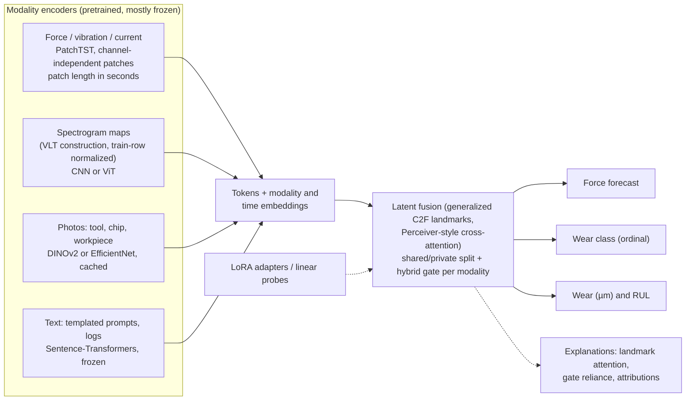

# Future work and analysis

A critical review of the OmniFuser implementation as it stands on 2026-10-22,
and a plan from here to the goals of **Project 14** (a multimodal foundation
model for reliability and predictive maintenance). For every finding it gives
the evidence, why it matters, and concrete implementation steps: files,
functions, code sketches, tests and documentation to change.

**Basis.** All modules and scripts were reread. Every number marked
*measured* came from the real Nonastreda data with the current code; the
snippets that produced them are in Appendix A. Numbers marked *estimated* are
extrapolated. Code sketches show the intended change and its place in the
codebase; check argument names against the installed library versions before
use.

**Related documents.** How the code works today: [`END_TO_END_SIM.md`](END_TO_END_SIM.md).
Paper versus code: [`PAPER_IMPLEMENTATION_ALIGNMENT.md`](PAPER_IMPLEMENTATION_ALIGNMENT.md).
How to run: [`TRAINING_RUNBOOK.md`](TRAINING_RUNBOOK.md).

---

## Contents

1. [Summary and priorities](#1-summary-and-priorities)
2. [How the analysis was done](#2-how-the-analysis-was-done)
3. [Evaluation by criterion](#3-evaluation-by-criterion)
4. [Findings and fixes](#4-findings-and-fixes)
5. [Will the project reach its goals?](#5-will-the-project-reach-its-goals)
6. [Target architecture for Project 14](#6-target-architecture-for-project-14)
7. [Papers and repositories to integrate](#7-papers-and-repositories-to-integrate)
8. [Roadmap and timeline](#8-roadmap-and-timeline)
9. [Risks and mitigations](#9-risks-and-mitigations)
- [Appendix A: measurement snippets](#appendix-a-measurement-snippets)
- [Appendix B: finding index](#appendix-b-finding-index)
- [Appendix C: links](#appendix-c-links)

---

## 1. Summary and priorities

**Verdict.**

- **As an OmniFuser reproduction, the project works.** The architecture,
  training and evaluation follow the paper (35 checked items, 3 documented
  deviations, each with a paper-literal run). The 137 tests and the
  real-data runs pass, and the review found no open code bug that would
  invalidate a run. Two bugs found this week are fixed: spectrogram fold
  reuse, and stochastic depth in the "frozen" backbone.
- **Three properties of the data decide what the main numbers mean**, and the
  main runs do not yet control for them:
  1. the photo shown at image lag 0 is taken *after* its pass and carries the
     target label;
  2. the run number, which the model receives, predicts the wear class with
     71 % accuracy on unseen tools;
  3. Fz is mostly sensor drift.
- **It is not a foundation model yet, and one dataset cannot make it one.**
  Nonastreda covers one tool type, one material and one parameter set: 10
  tools, 378 distinct passes. OmniFuser should become the fusion stage of a
  model pretrained on many PdM datasets.

**Do first, before the cluster runs** (about 1-2 days of work in total):

| Priority | Finding | Effort | Why now |
|---|---|---|---|
| 1 | F1 Report accuracy on label-changing targets and the gain over persistence | 0.5 day | Without it, main-run accuracy cannot be interpreted |
| 2 | F2 Metadata switch (`--metadata`) and a run-number baseline | 0.5 day | Separates wear sensing from run counting |
| 3 | F3 Fz handling and Fx/Fy-first regression metric | 0.5 day | Force error is partly drift error |
| 4 | F8 Slimmer per-epoch logs | 2 h | About 12 GB of logs otherwise (estimated) |
| 5 | F4 Smoothed model selection; F5 learning-curve check in the pilot | 0.5 day | Selection on 28 windows is noisy; possible under-training |

Everything else can follow the roadmap (§8).

---

## 2. How the analysis was done

1. Every file in `omnifuser/`, `scripts/` and `slurm/` was reread, together
   with `END_TO_END_SIM.md`, which documents each function's input, output
   and equations.
2. Suspected problems were measured on the real data (Appendix A):

   | Measurement | Result |
   |---|---|
   | Wear class predicted from the run number alone, leave-one-tool-out | **70.9 %** of passes (majority class 38.9 %); correlation run↔label 0.82 |
   | Same from the block number alone | 39.7 % (no better than the majority class) |
   | Same from (run, block) / from the pass index within the tool | 72.8 % / 68.0 % |
   | Fz along T10's first run (start→end of each pass) | B1 −6→−7 N, B2 −11→−28 N, B4 −36→−60 N; resets to −5 N at run 2 |
   | Correlation of per-pass mean with the label | Fx +0.60, Fy −0.55, **Fz −0.04** |
   | Flank-wear decreases along each tool's pass sequence (all 512 records) | 189 of 502 steps (132 inside a run, 57 between runs) |
   | Wear-class decreases along each tool's sequence (378 deduplicated passes) | 29 of 368 steps |
   | Spectrogram segments of 1 step / of at most 5 steps | 29 / 162 of 2,882 |
   | Metric rows per split and epoch in `metrics.csv` | 1,314 |
   | Photo size; resized size | 1550 × 500; 384 × 128 |
   | Validation windows of fold T10 (one tool, T1) | 28 |
   | Optimizer steps per fold (protocol) | 36 per epoch × 30 = 1,080 |
3. The published dataset description (Truchan & Ahmadi, *Data in Brief*
   2025) was read for the data's own documented limitations.

---

## 3. Evaluation by criterion

| Criterion | Rating | Detail |
|---|---|---|
| Code correctness | **Strong** | 137 tests cover leakage, numerical equivalence (cached features vs pixels, NumPy reference of the front end), competence (the model memorizes a batch and learns an image-only class), interruption and resume. The real-data smoke runs complete. |
| Fidelity to OmniFuser | **Strong** | Each block maps to its equation (`END_TO_END_SIM.md` §10). The 9 Fig. 13 ablations and 8 Fig. 7-8 sensitivity axes are implemented. The deviations (direct head, branch decomposition, normalized ALS) are justified and testable with the paper-literal arms. |
| Split and normalization leakage | **Strong** | Leave-one-tool-out with a separate validation tool; normalizer on training tools only; per-image image statistics; spectrograms from the input window only; strict fold-reuse checks. |
| Shortcut and label leakage in the inputs | **Weak** | The post-pass photo at lag 0 (F1), the run-number code (F2) and Fz drift (F3) let the model score without forecasting wear. |
| Experimental design | **Adequate** | Paper studies plus your own (image encoder, image source, duplicates, heads). Missing: significance tests (F11), several seeds (F14), external baselines (§7), robust model selection (F4). |
| Reproducibility | **Strong** | Seeds, settings signatures, resume, atomic saves, tracking of every metric, runtime history. GPU kernels are not forced deterministic (F21). |
| Efficiency | **Good** | Frozen-feature cache (3.9× faster CPU step) and on-device metrics. Remaining: spectrogram images rebuilt every epoch, frozen backbone stored in every checkpoint, heavy logs (F8, F17). |
| Documentation | **Strong** | Two runbooks, the audit, the alignment record, `END_TO_END_SIM.md`. |
| Evidence of generalization | **Weak** | Unseen tools of the same process are the only test. |
| Coverage of Project 14 | **Partial** | 2 of the dataset's 9 modalities; no pretraining, text, PEFT, explanations, transfer, calibration or uncertainty (§5). |

---

## 4. Findings and fixes

Severity: **High**, the results cannot be interpreted correctly without it;
**Medium**, it weakens a result or its cost; **Low**, worth doing.

### F1 (High). At image lag 0 the photo shows the target label

**Evidence.** `EDA.md` (§7, image lag) states that each photo is taken after
its pass. With the photo of the current pass (lag 0, main runs), copying the
photo's label gets about 91 % of targets right; with the previous pass's photo
(lag 1), about 77 %.

**Why it matters.** Main-run accuracy mostly measures reading the label off a
photo taken after the window. Prognosis is visible only on the targets whose
label differs from the photo's, roughly 9 % of them at lag 0.

**Implementation.**

1. Add a transition report in `omnifuser/evaluation.py`:

   ```python
   def transition_report(
       probabilities: np.ndarray, class_targets: np.ndarray, shown_label: np.ndarray
   ) -> dict[str, float | None]:
       """Accuracy on leads whose label differs from the shown image's label (the
       targets that need prognosis) and on the rest; skill over persistence."""
       predicted = probabilities.argmax(axis=-1)
       known = shown_label >= 0  # -1 = no image (lag 1, first pass)
       changed = (class_targets != shown_label[:, None]) & known[:, None]
       stable = (class_targets == shown_label[:, None]) & known[:, None]
       accuracy = float((predicted == class_targets).mean())
       persistence = float((class_targets == shown_label[:, None])[known].mean()) if known.any() else None
       return {
           "changed_fraction": float(changed.sum() / max(known.sum() * class_targets.shape[1], 1)),
           "changed_accuracy": float((predicted[changed] == class_targets[changed]).mean()) if changed.any() else None,
           "stable_accuracy": float((predicted[stable] == class_targets[stable]).mean()) if stable.any() else None,
           "skill_over_persistence": (
               (accuracy - persistence) / (1 - persistence)
               if persistence is not None and persistence < 1 else None
           ),
       }
   ```

2. Call it in `train._run_epoch`, inside `if collect_predictions:` next to
   `baseline_report`, and store it as `result["transition"]`.
3. In `cross_validation._summarize_folds` add
   `"classification_changed_accuracy": ("test", "transition", "changed_accuracy")`
   and `"classification_skill": ("test", "transition", "skill_over_persistence")`.
4. Add both to `SUMMARY_METRICS` in `scripts/run_experiment_suite.py`, and to
   `scripts/compare_with_paper.py`'s header.
5. **Test** (`tests/test_evaluation.py`): a hand-made array where two leads
   change label; check both accuracies, and that a shown label of −1 is
   excluded.
6. **Report:** make the lag-1 photo run and the spectrogram study
   (`image-source`) co-primary results, and always quote accuracy next to
   persistence and skill.

**Effort:** half a day.

### F2 (High). The run number is a 71 % shortcut

**Evidence (measured).** A classifier that predicts each pass's class as the
majority class of the same run number in the training tools reaches **70.9 %**
on held-out tools; the majority class alone gives 38.9 %. The correlation
between run number and label is 0.82. The block number alone gives 39.7 %
(no shortcut); (run, block) gives 72.8 %. The model receives the run number
through the `cycle` embedding table in both `TemporalEmbedding` and
`ImageBranch`.

**Why it matters.** A model can predict wear by counting runs. That is real
usage information in a factory (a cycle counter), but it is not sensing, and
it will not transfer to assets used at a different rate. Without a control,
gains cannot be attributed to the force or image signals.

**Implementation.**

1. `omnifuser/config.py`: add `metadata: str = "all"`, validated in
   `{"all", "position", "none"}`: all codes / only the within-pass position /
   none.
2. `omnifuser/models.py`: in `TemporalEmbedding.__init__` and
   `ImageBranch.__init__`, create the `cycle` and `batch` tables only for
   `"all"`, and the `relative` table for `"all"` and `"position"`. In
   `forward`, add only the codes whose tables exist.
3. `omnifuser/cli.py`: add `--metadata {all,position,none}` to
   `add_protocol_arguments`, and `"metadata": args.metadata` to the overrides
   in `protocol_kwargs`.
4. **Run-number baseline** in `train.train_fold` and `evaluation.baseline_report`:

   ```python
   # train_fold, after the training timelines exist
   run_votes: dict[int, Counter[int]] = defaultdict(Counter)
   for timeline in train_timelines:
       for run, label in zip(timeline.cycle_codes, timeline.labels):
           run_votes[int(run)][int(label)] += 1
   run_majority = {run: votes.most_common(1)[0][0] for run, votes in run_votes.items()}
   ```

   Collect `tensors["cycle"][:, -1]` in `_run_epoch` (like `shown_labels`),
   map it through `run_majority` (nearest known run if unseen), and add
   `"run_number_class_accuracy"` to `baseline_report`.
5. `scripts/run_experiment_suite.py`: a new study `shortcuts` with arms
   `metadata-all` (reference), `metadata-position`, `metadata-none`, and,
   after F3, `no-fz`.
6. **Tests:** `metadata="none"` creates no `cycle`/`batch`/`relative` tables
   and the model still runs; the baseline equals 1.0 on a synthetic fold where
   run determines the label.
7. **Docs:** a row in the runbook's argument table and in the variant table of
   `END_TO_END_SIM.md` (§17); the result belongs in the report's discussion
   of shortcuts.

**Effort:** half a day.

### F3 (High). Fz is mostly sensor drift

**Evidence.** The dataset authors report that the Fz axis drifts and is reset
every 1-3 instances, "so it mainly reflects sequence position". Measured on
T10's first run, Fz goes from −6 to −7 N (B1), −11 to −28 N (B2) and −36 to
−60 N (B4), then resets to −5 N at run 2. Its per-pass mean correlates with
the label at −0.04, against +0.60 for Fx and −0.55 for Fy.

**Why it matters.** A third of the force-forecast target is a sawtooth that
says nothing about wear. It inflates or deflates the regression error, uses
model capacity, and encodes sequence position (block), which overlaps with
the metadata codes.

**Implementation.**

1. **Primary metric first** (no retraining): report Fx and Fy MSE/MAE as the
   main regression numbers. They already exist in
   `regression.by_channel_normalized`. Add an `fx_fy` aggregate in
   `evaluation.regression_report` and in the suite summary.
2. **Channel selection** for an ablation:
   - add `force_channels: tuple[int, ...] = (0, 1, 2)` to `train_fold`, and
     slice `record.force[:, force_channels]` in `load_timelines` after
     pooling;
   - set `ModelConfig.force_channels = len(force_channels)`;
   - replace the three hard-coded `("Fx", "Fy", "Fz")` tuples in
     `train._run_epoch`, `evaluation.regression_report` and
     `cross_validation._aggregate_out_of_fold` with names derived from
     `force_channels`;
   - spectrograms keep all three axes, since they use raw passes.
3. **Causal offset removal** as an alternative to dropping Fz: subtract each
   pass's first pooled Fz value from the whole pass (known as soon as the pass
   starts, so causal). This removes the sawtooth level; the drift slope inside
   a pass remains. Flag `--fz-offset {none,pass-start}`, applied in
   `load_timelines`.
4. **Ablation arms** in the `shortcuts` study (F2): `no-fz`, `fz-pass-start`.
5. **Docs:** add the drift to `EDA.md` (it is missing) with the T10 numbers.

**Effort:** half a day for steps 1, 2 and 4.

### F4 (Medium). Model selection rests on one validation tool

**Evidence.** The best epoch is chosen from one tool's windows: 28 in fold T10
(T1), at most about 53 in any fold. The criterion is the total loss, MSE plus
cross-entropy.

**Implementation.**

1. Add `--model-selection {best,smoothed,last}` (replacing the boolean
   `--select-best`, kept as an alias). `smoothed` keeps the weights of the
   epoch whose trailing 3-epoch mean validation loss is lowest:

   ```python
   recent = collections.deque(maxlen=3)
   ...
   recent.append(validation_metrics["loss"])
   score = sum(recent) / len(recent)
   if score < best_score:
       best_score, best_epoch = score, epoch
       best_state = {k: v.detach().cpu().clone() for k, v in model.state_dict().items()}
   ```

2. Save the deque in the resume file, and put the selection mode in the resume
   signature and in `_load_finished_fold`'s expected settings.
3. In the report, also give the last-epoch test score of each main run (one
   extra test pass; store it as `result["test_last_epoch"]`), which shows how
   sensitive the result is to selection.

**Effort:** 3 hours.

### F5 (Medium). The model may be under-trained

**Evidence.** The protocol gives 36 batches × 30 epochs = 1,080 Adam steps at
learning rate 1e-4 for 176,052 trainable parameters, with no schedule.

**Implementation.**

1. In the pilot (runbook step 2), open
   `experiment_results/pilot/T10/tracking/metrics.csv` and plot the validation
   loss by epoch. If it still falls at the end, train longer or faster.
2. Add `--lr-schedule {constant,cosine}` and `--warmup-epochs N` in
   `train_fold`, implemented with `torch.optim.lr_scheduler.LambdaLR`, stepped
   at every optimizer step:

   ```python
   steps_per_epoch = math.ceil(len(train_loader) / accumulation_steps)
   total, warmup = epochs * steps_per_epoch, warmup_epochs * steps_per_epoch

   def factor(step: int) -> float:
       if step < warmup:
           return (step + 1) / warmup
       progress = (step - warmup) / max(total - warmup, 1)
       return 0.5 * (1 + math.cos(math.pi * progress))
   scheduler = torch.optim.lr_scheduler.LambdaLR(optimizer, factor)
   ```

   Save `scheduler.state_dict()` in the resume file; add both flags to the
   signature.
3. Run a 3-point learning-rate check on one fold (1e-4, 3e-4, 1e-3; 30
   epochs; cosine). Choose on the validation tool only, never on the test
   tool, and record the choice in the protocol.

**Effort:** half a day plus 3 pilot runs.

### F6 (Medium). Spectrograms lose the absolute energy level

**Evidence.** `spectrogram.force_window_image` z-scores each of the 7 maps on
its own (`_standardize`), which removes the absolute power, the classic sign of
wear: vibration energy rises as the edge dulls.

**Implementation.**

1. Give `force_window_image` a `normalization` argument: `"per_image"`
   (current) or `"train_rows"`.
2. With `"train_rows"`, standardize each (map, frequency row) with statistics
   fitted on the **training tools only**, as `ForceNormalizer` does:

   ```python
   @dataclass(frozen=True)
   class SpectrogramStatistics:
       mean: np.ndarray  # (6, 128): STFT and FFT maps, per frequency row
       std: np.ndarray

       @classmethod
       def fit(cls, dataset: "ForceWindowDataset") -> "SpectrogramStatistics":
           # One pass over the training windows with standardization off; Welford
           # accumulation per (map, row) over all columns and windows.
           ...
   ```

   The recurrence map stays per image (it is already scale-free).
3. Fit the statistics in `train_fold` from the training `ForceWindowDataset`
   before building the loaders (one extra pass: about 1,150 windows × 70 ms ≈
   80 s on one core), and pass them to the validation and test datasets.
4. Add `--spectrogram-normalization {per_image,train_rows}`; record it in
   `SpectrogramSettings` so it reaches the fold signature.
5. **Test:** two synthetic windows that differ only by a gain of 2 give
   identical images with `per_image` and different images with `train_rows`.

**Effort:** half a day.

### F7 (Medium). Recurrence maps are distorted for short segments

**Evidence.** 29 of the 2,882 window segments are one step long (1,000
samples, 12 STFT frames stretched to 384 columns), and 162 are at most 5 steps.
The recurrence distances are computed after the stretch, so duplicated
columns (distance 0) dominate the 10 % threshold.

**Implementation.** In `force_window_image`, compute the recurrence on the
native STFT frames, then resize:

```python
frames = log_power.permute(2, 0, 1).reshape(log_power.shape[-1], -1)  # (F, 3*129)
distances = torch.cdist(frames, frames)                               # (F, F), F <= 1,497
threshold = torch.quantile(distances.flatten(), settings.recurrence_rate)
recurrence = (distances <= threshold).float()
recurrence = F.interpolate(recurrence[None, None], size=(height, width), mode="area")[0]
```

For F = 1,497 the distance matrix has 2.2 M entries (9 MB), which is fine. Add
a test that a 1-step segment gives a recurrence map with no stretching
artifacts: a diagonal band whose width scales with the frame count.

**Effort:** 2 hours.

### F8 (Medium). Per-epoch logs are too large (estimated)

**Evidence.** Every epoch writes 1,314 metric rows per split to `metrics.csv`,
mostly per-lead and per-class lists. A 1-epoch, capped fold produced a
0.84 MB fold JSON. Extrapolated to 30 epochs, 10 folds and the full
history: about 0.3 GB per 10-fold run, about 12 GB over the ~40 planned runs,
plus about 7 GB of checkpoints (F17).

**Implementation.**

1. A helper in `train.py` that keeps the scalar summary of an epoch:

   ```python
   EPOCH_KEYS = ("loss", "force_loss", "class_loss", "alignment_loss",
                 "orthogonality_loss", "classification_accuracy",
                 "force_mse_normalized", "force_mae_normalized", "force_rmse_normalized")

   def _epoch_summary(metrics: dict[str, Any]) -> dict[str, Any]:
       summary = {key: metrics[key] for key in EPOCH_KEYS if key in metrics}
       summary["regression"] = {k: metrics["regression"][k] for k in ("overall", "normalized", "by_channel_normalized")}
       c = metrics["classification"]
       summary["classification"] = {k: c[k] for k in c if k.endswith(("_macro", "_weighted")) or k == "accuracy"}
       summary["classification"]["roc_auc_macro"] = c["roc_auc_ovr"]["macro"]
       return summary
   ```

2. Use it for the per-epoch `tracker.log` calls and for `history`. Keep the
   full metrics for the final evaluations.
3. Keep `cross-validation-results.json` small: store the per-fold results
   without `history` (the fold JSONs keep it).

**Effort:** 2 hours. Expected reduction: about 90 % of the log volume.

### F9 (Medium). Photos are shrunk 4×

**Evidence.** Photos are resized from 1550 × 500 to 384 × 128 before the
encoder, and the flank-wear zone is a small part of the image.

**Implementation.**

1. Expose `--image-height` and `--image-width` in `add_protocol_arguments`
   (they exist in `ModelConfig` but have no flag), passed as
   `config_overrides`.
2. With the frozen backbone the features are computed once per fold
   (`FrozenFeatureBank`), so 256 × 768 costs about 4× the 9 s bank build and
   nothing per epoch. The `ImageBank` cache grows to about 0.2 GB.
3. Optional: a fixed crop around the cutting edge, defined once from a few
   photos (a crop box in `ImageBank.__init__` before resizing).
4. An `image-resolution` study: 128 × 384 (protocol), 256 × 768, crop.

**Effort:** 3 hours plus runs.

### F10 (Medium). Unused data: chip and workpiece photos, measured wear

**Evidence.** The published Nonastreda has nine modalities: tool (`tool/`),
chip (`chip/`) and workpiece (`work/`) photos, per-axis scalograms and
spectrograms, and the raw force. `labels_reg.csv` gives the flank wear in µm
(22.6 to 346.7 µm, median 81.4). The local copy has only `tool/`; the
pipeline uses `tool/` and the force.

**Implementation.**

1. **Download** the full dataset from Mendeley (DOI 10.17632/m892d2wtzh.1).
   The precomputed whole-pass spectrograms and scalograms must not be used at
   lag 0: they cover the forecast window. Use them only at lag 1.
2. **More image modalities:**
   - `load_nonastreda(..., image_dirs=("tool",))`, with `Record.image_paths`
     becoming a mapping modality → path;
   - `make_tool_timelines` gets one `image_codes` array per modality;
   - the model gets one `ImageBranch` per modality (they can share the frozen
     encoder's feature cache), then a fusion that accepts more than two
     streams (F10b);
   - the chip and workpiece photos are also taken after the pass, so the lag
     rules of F1 apply to them.
3. **F10b. Fusion of N streams.** The quickest correct option is a hub:
   - sensor ↔ each image stream through its own C2F layer;
   - then a mean (or a learned softmax weight) over the fused outputs.

   The scalable option is a shared latent array (Perceiver IO style, §7) that
   generalizes C2F's landmarks.
4. **Wear regression head:**
   - `Record.flank_wear` (already read for duplicate merging), and a
     `ToolTimeline.wear` array;
   - `WindowDataset` item `wear_target` $(P,)$, z-scored with training-tool
     statistics;
   - `OmniFuser` head `direct_wear = nn.Linear(d, P)`;
   - loss $\mathcal{L} = \text{MSE}_F + \text{CE} + \lambda\,\text{MSE}_{\text{wear}}$, with `--wear-weight λ` (default 0, so main runs are unchanged);
   - metrics: MAE and RMSE in µm, overall and per lead. Use the smoothed wear
     of F12 as the target.

**Effort:** 1 day for the wear head; 2-3 days for more image modalities with
hub fusion.

### F11 (Medium). No significance tests

**Implementation.** A new script, `scripts/compare_runs.py RUN_A RUN_B [--metric NAME]`:

1. Read both `cross-validation-results.json` files and take
   `cv_mean_std.metrics[NAME].per_fold` (the 10 test tools in the same order).
2. Report the mean difference, a paired t-test (`scipy.stats.ttest_rel`), a
   Wilcoxon signed-rank test (`scipy.stats.wilcoxon`), and a 95 % bootstrap
   interval of the mean difference (10,000 resamples of the folds).
3. For a study with many arms against one reference (ablations: 8 arms), apply
   Holm's correction.
4. Write a table for the report.
5. **Test** with two synthetic result files.

**Effort:** 3 hours.

### F12 (Medium, new). Labels are noisy near the thresholds; wear is not monotonic

**Evidence (measured).** Along each tool's pass sequence the measured flank
wear decreases 189 times out of 502 steps (all 512 records), 132 of them
inside a run. The class decreases 29 times out of 368 steps (378 deduplicated
passes). Example, T2 run 5: 65, 68, 72, 68 µm, labelled
sharp, sharp, used, sharp; the threshold is 71 µm. The underlying wear grows;
the measurements carry about ±10 µm of noise.

**Why it matters.** Classification near the thresholds partly scores
measurement noise. RUL targets built from the raw wear would jump backwards.
Macro F1 treats sharp↔dulled the same as sharp↔used.

**Implementation.**

1. **Smoothed wear** per tool for regression and RUL:

   ```python
   from scipy.optimize import isotonic_regression
   smoothed = isotonic_regression(wear_in_pass_order).x  # non-decreasing least-squares fit
   ```

   For example, [68, 72, 68, 76] becomes [68, 70, 70, 76]. Compute it per tool
   in `load_nonastreda` (store both raw and smoothed); never mix tools.
2. **RUL in passes:** for each pass, the number of passes until the smoothed
   wear first reaches 110 µm (the dulled threshold). Passes of tools that
   never reach it are right-censored. Report RUL MAE on uncensored passes, or
   use a censoring-aware loss later.
3. **Ordinal metrics** in `evaluation.classification_report`: mean absolute
   class error $\frac{1}{N}\sum|\hat c-c|$ and quadratic-weighted Cohen's
   kappa.
4. **Optional ordinal loss:** CORAL or cumulative-link logits (§7,
   `coral-pytorch`) instead of softmax; flag `--class-loss {ce,coral}`.
5. **Label-noise sensitivity:** report accuracy on passes whose smoothed wear
   is more than 10 µm from a threshold (the confidently labelled passes).

**Effort:** 1 day.

### F13 (Medium, new). No calibration or uncertainty

**Why it matters.** Project 14's "trustworthy output" goal needs probabilities
that mean what they say, and intervals for RUL.

**Implementation.**

1. In `evaluation.classification_report`, add the **expected calibration
   error** and the **Brier score**:

   $$\mathrm{ECE}=\sum_{b=1}^{15}\frac{|B_b|}{N}\,\big|\mathrm{acc}(B_b)-\mathrm{conf}(B_b)\big|,\qquad
   \mathrm{Brier}=\frac1N\sum_i\sum_c (p_{ic}-y_{ic})^2.$$
2. **Temperature scaling** (Guo et al., 2017): after training, fit one scalar
   $\tau$ on the **validation tool's** logits by minimizing the negative log
   likelihood (`torch.optim.LBFGS`), then report test metrics with
   $\operatorname{softmax}(\ell/\tau)$. This needs the validation logits:
   collect predictions on the validation loader once at the end.
3. **Uncertainty:** an ensemble over seeds (F14) gives a spread at no extra
   code. Alternatively, Monte Carlo dropout with 20 stochastic forward passes
   in train mode at test time (`--mc-dropout 20`) gives a predictive standard
   deviation for the force, wear and RUL heads.

**Effort:** 1 day.

### F14 (Medium, new). One seed per fold

**Evidence.** Each fold runs once (seed 42 + fold index). Fold-to-fold
variation mixes tool difficulty with training noise.

**Implementation.** Add `--seeds 42 43 44` to `run_experiment_suite.py`, which
expands every variant into one run per seed (`<variant>/seed-43/`). Summaries
then report the mean ± std over seeds of the fold means. Run three seeds for
step 3a and the image-source study at least.

**Effort:** 2 hours of code; three times the compute for those runs.

### F15 (Medium, new). No comparison with the dataset's own benchmark

**Evidence.** The dataset authors report "approximately 75 %" accuracy under
the same 10-fold leave-one-tool-out protocol, for classifying each pass from
its own data. OmniFuser forecasts per-step classes, so the numbers are not
comparable as they stand.

**Implementation.**

1. **Pass-level aggregation of the forecasts:** add `target_pass` $(P,)$ (the
   index of each target step's pass within the tool) to the `WindowDataset`
   item, save it in the prediction files, and report the accuracy of the
   majority-voted class per pass over leads $\le h$.
2. **Current-pass classification variant**, `--target current`: the class
   head predicts the label of the input window's last pass instead of future
   leads (horizon 0 for the class head; the force head unchanged). This
   matches the authors' task, so the comparison with 75 % is direct. At image
   lag 0 the photo is that pass's own photo, so report it with photos and
   without (`image_missing`).

**Effort:** 1 day.

### F16 (Low-medium, new). Tool-to-tool shift is not addressed

**Evidence.** Per-pass force levels differ between tools (`EDA.md`), and the
model is tested on an unseen tool.

**Implementation.** An option for **reversible instance normalization**
(RevIN, Kim et al., ICLR 2022; §7): normalize each input window by its own
mean and std, forecast in that space, and de-normalize the force output with
the same statistics. About 30 lines in `OmniFuser.forward`, flag
`--revin`. It removes absolute force levels from the input, which may also
remove wear information (absolute force rises with wear), so run it as an
ablation, not a default.

**Effort:** half a day.

### F17 (Low-medium). Efficiency

| Item | Evidence | Change |
|---|---|---|
| Frozen backbone in every checkpoint | Each `fold-Tn.pt` is about 17 MB; 4.0 M of its 4.18 M parameters are the fixed ImageNet trunk | When `freeze_image_encoder`, save only the other parameters plus the weights' name (`IMAGENET1K_V1`); about 0.7 MB per fold. The trunk is rebuilt from torchvision on load. |
| Spectrogram images rebuilt every epoch | 12 ms per 96 s image; about 30 epochs × 1,150 windows per fold | Cache each window's images once per fold in a float16 memory-mapped file on the node's local disk (about 1.7 GB per fold), or keep rebuilding (CPU-bound but parallel over 4 workers) |
| Three extra passes over the training set at the end | `train` evaluations in 3 modes | Flag `--no-train-evaluation` for studies where only test metrics matter |
| Workers restarted every epoch | `persistent_workers=False` | `persistent_workers=num_workers > 0` |
| No mixed precision | A100 nodes | `torch.autocast("cuda", dtype=torch.bfloat16)` around the forward pass; keep the loss and metric sums in float32/float64 |

### F18 (Low). The orthogonality diagnostic is always zero

`CrossModalFusionLayer` logs $\langle S, Z-cS\rangle_F^2$, which is 0 by
construction in both split modes (`END_TO_END_SIM.md` §10.5). Replace it with
an informative ratio, $\lVert P\rVert_F / \lVert Z\rVert_F$ (how much of the
stream is private), or remove it.

### F19 (Low). MRTE has no residual path

MRTE returns only the sum of restored components, so the most recent 1 s
steps reach the heads only through 3× downsampled paths, and the head reads
only the last step. Add `--mrte-residual`, $Z^r=E+\sum_l\tilde U^{(l)}$, and
test it against the paper form in the sensitivity study. It may help the
short leads, where the last-value baseline is strong.

### F20 (Low). Inputs that depend on the whole pass

The position-in-pass code uses the pass length, and pass trimming uses the
whole pass's envelope. Both are fine offline, and the paper uses the position
code. For online deployment, document the assumption: the toolpath is
planned, so pass length is known in advance. Alternatively, switch to
causal versions: the elapsed time in the pass instead of the fraction, and
trimming only of the start.

### F21 (Low). GPU determinism

Add `--deterministic`, which calls `torch.use_deterministic_algorithms(True, warn_only=True)`
and sets `torch.backends.cudnn.benchmark = False`. Use it for runs whose exact
numbers go in the paper.

### F22 (Low). Passes are concatenated as continuous time

Timelines join passes back to back, although real time passes between them
(the photo is taken in between). The paper does the same; state it in the
report. A pass-boundary indicator token, or excluding forecasts that cross a
boundary, are possible variants.

### F23 (Low, new). Release and engineering

| Item | Change |
|---|---|
| No `LICENSE` file | Add one (MIT or Apache-2.0) before publishing the repository, which is Project 14 deliverable 4. Check the dataset's licence on Mendeley separately; it is not stated in the article. |
| No continuous integration | `.github/workflows/tests.yml`: Ubuntu, Python 3.12, `pip install -e ".[test,dev]"` with CPU torch, then `ruff check .`, `pyright` and `pytest`. The suite needs neither the data nor the ImageNet weights and runs in about a minute. |
| Data signature uses size and modification time | Add SHA-256 checksums of the data files to `nonastreda_source_signature` for the published runs, so a reader can verify they have the same data. |
| No citation file | `CITATION.cff`; archive releases on Zenodo for a DOI. |
| Data and model documentation | A datasheet for the curated data (Gebru et al., "Datasheets for Datasets") and a model card (Mitchell et al., "Model Cards for Model Reporting"); deliverable 3 needs the former. |
| `cross-validation-progress.json` is written in place | Write it atomically like the other files. It is only informational, so this is cosmetic. |

---

## 5. Will the project reach its goals?

### 5.1 An OmniFuser-like architecture for multimodal PdM

**Yes.** The implementation contains every OmniFuser component:

- the temporal embedding;
- MRTE with RTD blocks;
- the EfficientNet and graph-attention image branch;
- C2F fusion with shared/private decomposition, adaptive landmarks and the
  hybrid gate;
- recursive refinement and the prediction heads.

The studies the paper reports (ablations, sensitivity, missing modality,
horizons) can all be run. It is also more careful than the paper about
leakage and reproducibility. The remaining work is about how results are
measured and reported (F1-F3), not about the architecture.

### 5.2 Generalization to unseen data

**Partly, and only within one process.** Leave-one-tool-out cross-validation
measures generalization to an unseen tool of the same type, on the same
machine, material and parameters. The dataset authors list exactly these as
the dataset's limits. It cannot show generalization to other machines,
sensors, materials or failure modes. With F2 unresolved, even the unseen-tool
result may partly reflect run counting.

### 5.3 Potential as a PdM foundation model

**Not in its current form.** A foundation model needs:

1. **Pretraining at scale** on many assets without labels, while the current
   model is supervised on 378 passes;
2. **Inputs that adapt** to varying channels, sampling rates and modalities,
   while the current code is fixed to 3 force channels and 1-2 image streams;
3. **Transfer** to new assets with few or no labels (zero-shot, few-shot,
   PEFT), which is not implemented;
4. **Capacity:** $d=32$ with 176 k trainable parameters suits 378 passes, but
   not a multi-dataset model.

OmniFuser's parts are good building blocks for such a model. The adaptive
landmarks are a compact way to summarize a modality, and the shared/private
split plus the gate give interpretable fusion. The path is to keep them as
the fusion stage and put pretrained, modality-flexible encoders in front
(§6).

### 5.4 Project 14 goals against the current state

| Goal | Current state | Gap | Plan section |
|---|---|---|---|
| Unified backbone fusing high-frequency sensors with low-frequency data | Force (1 kHz → 1 Hz) + tool photo; spectrograms recover sub-second content | Text, more images, any number of modalities | F10, §6.2 |
| Self-supervised pretraining | None | Masked-patch force pretraining; cross-modal contrastive alignment | §6.3 |
| Generalization and adaptation to unseen assets | Unseen tools of one process | Multi-dataset corpus; leave-one-dataset-out; few-shot; PEFT | §6.4, §6.5 |
| Trustworthy output and XAI | None | Calibration, uncertainty, attributions, cross-modal attention maps | F13, §6.6 |
| Leakage control | Strong for splits | Shortcut controls | F1-F3 |
| Report, paper, data, code | Code and docs strong | Licence, datasheet, model card, citation | F23 |

---

## 6. Target architecture for Project 14

### 6.1 Overview



### 6.2 Modality-flexible inputs

1. **Sensors.** Turn each channel into patches of fixed duration (for example
   0.25 s), resampling to a common rate per dataset. Each patch gets a channel
   embedding (sensor type and axis) and a time embedding (seconds since the
   window start). PatchTST's channel independence handles any number of
   channels.
2. **Images.** Every photo type becomes one token per image, from a frozen
   encoder with features cached per dataset (as `FrozenFeatureBank` does
   now), plus a modality embedding (tool, chip, workpiece, thermal).
3. **Text.** Templated prompts from the input window's own statistics, the
   VLT §III-D recipe (means, spread, slope, dominant frequencies), and real
   maintenance logs where they exist. Encode with a frozen sentence encoder.
   **Leakage rule:** prompts may use only the input window and data known
   before it. Never put the run number in the text unless F2 says that is
   intended.
4. **Fusion.** Generalize C2F from two streams to N:
   - each modality $m$ gets its shared/private split and its landmarks $\Lambda^m$;
   - a shared latent array of $K$ queries attends to all modalities' landmark
     tokens (Perceiver IO);
   - each modality's hybrid gate mixes the latent context with its private
     path;
   - modality dropout during pretraining makes missing modalities a normal
     case.

### 6.3 Self-supervised pretraining

| Objective | Data | Loss | Purpose |
|---|---|---|---|
| Masked patch reconstruction (PatchTST) | All sensor streams, unlabelled | MSE on 40 % masked patches | A general sensor encoder |
| Cross-modal contrastive (CLIP, ImageBind) | Windows with ≥ 2 modalities | InfoNCE between the pooled embeddings of two modalities of the same window; other windows in the batch as negatives | A shared embedding space; the basis for zero-shot |
| Next-window forecasting | Sensor streams | MSE | Keeps the temporal dynamics |

**Pretraining leakage rule:** the assets and tools used for evaluation are
excluded from pretraining. Leave-one-dataset-out also excludes the held-out
dataset from pretraining.

### 6.4 Evaluation protocol for "foundation" claims

1. **In-domain:** leave-one-tool-out on Nonastreda, as now, with F1-F3
   controls.
2. **Cross-asset:** leave-one-dataset-out over the corpus (§7.6): pretrain
   without dataset $D$, then evaluate on $D$.
3. **Few-shot:** $k\in\{1,5,10\}$ labelled passes or cycles per class from the
   target asset. Repeat 5 times with different draws and report mean ± std.
4. **Adaptation methods:** linear probe; LoRA ($r\in\{4,8\}$) on the fusion
   attention and projection layers; full fine-tuning.
5. **Zero-shot:**
   - forecasting through the pretrained forecast head;
   - classification by similarity to class prompts in the contrastive space,
     where a text modality exists.

### 6.5 PEFT

LoRA freezes the pretrained weights $W$ and learns a low-rank update,
$W'=W+\tfrac{\alpha}{r}BA$ with $A\in\mathbb{R}^{r\times k}$ and
$B\in\mathbb{R}^{d\times r}$. In this codebase the targets are the `nn.Linear`
layers of `CrossModalFusionLayer`:

- `shared_r`, `shared_i`, `value_r`, `value_i`;
- the gate projections;
- `project`.

The heads stay fully trainable. See §7.4 for the code.

### 6.6 Explanations

1. **Cross-modal attention, already computed:**
   - $\operatorname{softmax}(S^r\Lambda^{i\top}/\sqrt d)$ shows which image
     landmarks each force step uses;
   - the landmark weights $\omega$ show which steps form each landmark;
   - the gate $g^r_t$ shows, per step, how much the prediction relies on
     cross-modal context rather than the private path.

   Expose them with a `return_attention=True` argument on
   `CrossModalFusionLayer.forward` and `OmniFuser.forward`.
2. **Attributions:** Integrated Gradients (Captum) with respect to the force
   input and the image features, for a chosen lead and class.
3. **Faithfulness checks:**
   - deletion curves: mask the most-attributed steps and measure the score drop;
   - weight-randomization sanity checks (Adebayo et al., 2018), which an
     explanation method must fail when the model is random.
4. **Report** a per-prediction card: modality reliance, top input regions, and
   the calibrated probability (F13).

---

## 7. Papers and repositories to integrate

Each entry gives its role, the install, a minimal integration sketch, where
it plugs into this code, the effort, and its pitfalls.

### 7.1 Sensor encoders and baselines

**PatchTST** — Nie et al., "A Time Series is Worth 64 Words", ICLR 2023.
Repository `yuqinie98/PatchTST`; also in Hugging Face `transformers`.

- *Role:* patch-based Transformer with channel independence and masked-patch
  pretraining: the sensor encoder of §6, and a strong forecasting baseline.
- *Install:* `pip install transformers`.
- *Sketch:*

  ```python
  from transformers import PatchTSTConfig, PatchTSTForPretraining
  config = PatchTSTConfig(num_input_channels=3, context_length=4096, patch_length=64,
                          patch_stride=64, do_mask_input=True, mask_type="random",
                          random_mask_ratio=0.4, d_model=128, num_hidden_layers=3,
                          num_attention_heads=4)
  model = PatchTSTForPretraining(config)
  loss = model(past_values=raw_windows).loss  # raw_windows: (B, 4096, 3), 1 kHz force
  ```

- *Where:* pretrain on raw passes (`raw_passes_by_tool` already gives them).
  Then replace or complement `MultiResolutionTemporalExtractor`: the patch
  tokens, mean-pooled per pooled step, give $(B,T,d)$.
- *Effort:* 2-3 days. *Pitfall:* tune the patch length to the physics (64
  samples is 64 ms at 1 kHz).

**MOMENT** — Goswami et al., ICML 2024. Repository
`moment-timeseries-foundation-model/moment`; `pip install momentfm`.

- *Role:* an open pretrained time-series foundation model; frozen embeddings
  for linear probes and few-shot baselines.
- *Sketch:*

  ```python
  from momentfm import MOMENTPipeline
  model = MOMENTPipeline.from_pretrained("AutonLab/MOMENT-1-large",
                                         model_kwargs={"task_name": "embedding"})
  model.init()
  embeddings = model(x_enc=windows).embeddings  # windows: (B, channels, 512)
  ```

- *Where:* a baseline arm: MOMENT embeddings → logistic regression per fold.
- *Effort:* 1 day. *Pitfall:* fixed input length of 512; resample or crop.

**Chronos** — Ansari et al., TMLR 2024. Repository
`amazon-science/chronos-forecasting`; `pip install chronos-forecasting`.

- *Role:* zero-shot forecasting baseline for the force head.
- *Sketch:* `ChronosPipeline.from_pretrained("amazon/chronos-t5-small").predict(context, prediction_length=64)`,
  per channel.
- *Effort:* half a day. *Pitfall:* univariate; quality drops beyond 64 steps.

**Time-Series-Library (TSLib)** — `thuml/Time-Series-Library`.

- *Role:* one codebase with DLinear, PatchTST, iTransformer, TimesNet and
  others; the paper's missing time-series baselines.
- *Where:* write a dataset adapter that exports our windows (z-scored, same
  folds) to its loader, or import the model classes directly and train them
  with `train_fold`'s loop as force-only arms.
- *Effort:* 2 days. *Pitfall:* keep the folds, normalization and window caps
  identical to ours.

**TS2Vec** — Yue et al., AAAI 2022. Repository `zhihanyue/ts2vec`.

- *Role:* contrastive self-supervised representations; a cheap pretraining
  baseline.
- *Sketch:* `TS2Vec(input_dims=3, output_dims=320).fit(train); encode(test, encoding_window="full_series")`.
- *Effort:* 1 day.

**RevIN** — Kim et al., ICLR 2022. Repository `ts-kim/RevIN`. The
instance-normalization option of F16 (about 30 lines).

### 7.2 Fusion and alignment

**Perceiver IO** — Jaegle et al., ICLR 2022. Hugging Face `PerceiverModel`.

- *Role:* a latent array attending to any number of modality tokens; the
  N-modality generalization of C2F's landmarks.
- *Where:* a new fusion option between the branches and the heads; keep the
  shared/private split and gates per modality on the input side.
- *Effort:* 3-4 days.

**MBT** — Nagrani et al., "Attention Bottlenecks for Multimodal Fusion",
NeurIPS 2021. Reference code `google-research/scenic` (JAX).

- *Role:* one of the paper's fusion baselines (§19 of the runbook lists them as
  missing).
- *Where:* a `BottleneckFusionLayer` in `models.py` with the
  `ConcatenationFusionLayer` interface: $(Z^r, Z^i) \to (F, 0, 0)$.
  Bottleneck tokens join each stream's self-attention, and only they cross
  between modalities. About 60 lines in PyTorch.
- *Effort:* 1 day.

**CLIP / ImageBind.** Radford et al., ICML 2021; Girdhar et al., CVPR 2023.
Repositories `mlfoundations/open_clip`, `facebookresearch/ImageBind`.

- *Role:* the contrastive alignment objective of §6.3. The loss itself is a
  few lines:

  ```python
  def info_nce(a: torch.Tensor, b: torch.Tensor, temperature: float = 0.07) -> torch.Tensor:
      a, b = F.normalize(a, dim=-1), F.normalize(b, dim=-1)
      logits = a @ b.T / temperature
      targets = torch.arange(len(a), device=a.device)
      return 0.5 * (F.cross_entropy(logits, targets) + F.cross_entropy(logits.T, targets))
  ```

- *Pitfall:* ImageBind's weights are non-commercial; use the idea, not
  necessarily the weights.

**DINOv2** — Oquab et al., TMLR 2024. Repository `facebookresearch/dinov2`.

- *Role:* self-supervised image features, often better than ImageNet
  classification features for texture such as wear surfaces.
- *Sketch:* `torch.hub.load("facebookresearch/dinov2", "dinov2_vits14")`; input
  sides must be multiples of 14 (for example 126 × 378).
- *Where:* an `image_encoder="dinov2_vits14"` option in `ImageFeatureEncoder`,
  used frozen through `FrozenFeatureBank` (384 features).
- *Effort:* 1 day.

### 7.3 Text

**Sentence-Transformers** — Reimers & Gurevych, EMNLP 2019;
`pip install sentence-transformers`.

- *Sketch:* `SentenceTransformer("all-MiniLM-L6-v2").encode(prompts)` gives
  384-dimensional vectors, cached per window.
- *Where:* a text modality built from VLT-style prompts (§6.2), fused like an
  image stream.
- *Effort:* 1 day.

**MaintNet** — Akhbardeh et al., COLING 2020 (demo).

- *Role:* real maintenance logbooks from aviation, automotive and facility
  maintenance, for text pretraining or alignment, though not paired with our
  sensors.
- *Effort:* 2 days of curation.

**Time-LLM** — Jin et al., ICLR 2024. Repository `KimMeen/Time-LLM`. LLM
reprogramming for time series; heavy, so only if an LLM-based text pathway
becomes central.

### 7.4 Parameter-efficient fine-tuning

**LoRA** — Hu et al., ICLR 2022. Hugging Face `peft` (`pip install peft`).

- *Sketch:*

  ```python
  from peft import LoraConfig, get_peft_model
  lora = LoraConfig(r=8, lora_alpha=16, lora_dropout=0.0,
                    target_modules=["shared_r", "shared_i", "value_r", "value_i",
                                    "global_gate_r", "global_gate_i", "project.0", "project.2"])
  adapted = get_peft_model(pretrained_omnifuser, lora)
  adapted.print_trainable_parameters()
  ```

- *Where:* a new `--peft lora` mode in `train_fold`: load pretrained weights,
  wrap, and train only the adapters and heads.
- *Effort:* 1-2 days. *Pitfall:* `nn.MultiheadAttention` needs special
  support; target its `out_proj` or the surrounding linear layers.

### 7.5 Trust: explanations, calibration, ordinal outputs

| Work | Repository / install | Role | Effort |
|---|---|---|---|
| Captum (Kokhlikyan et al., 2020) | `pip install captum` | Integrated Gradients on force inputs and image features | 1-2 days |
| Attention rollout (Abnar & Zuidema, ACL 2020) | a few lines | Aggregating attention over the GAT and C2F layers | half a day |
| Sanity checks for saliency maps (Adebayo et al., NeurIPS 2018) | method | Faithfulness test of every explanation | half a day |
| Temperature scaling (Guo et al., ICML 2017) | `gpleiss/temperature_scaling` | Calibration (F13) | half a day |
| CORAL ordinal regression (Cao, Mirjalili & Raschka, 2020) | `pip install coral-pytorch` | Ordinal wear classes (F12) | half a day |

*Captum sketch:*

```python
from captum.attr import IntegratedGradients

def class_score(force: torch.Tensor) -> torch.Tensor:
    out = model(force, images, image_indices, cycle, batch_code, relative)
    return out["class_logits"][:, lead, target_class]

attributions = IntegratedGradients(class_score).attribute(
    force, baselines=torch.zeros_like(force), n_steps=50)  # (B, T, 3): importance per step and axis
```

### 7.6 Datasets for pretraining and cross-asset tests

| Dataset | Asset / signals | Labels | Use |
|---|---|---|---|
| Nonastreda (full) | Milling; force + tool, chip, workpiece photos | Wear class, flank wear µm | In-domain; more modalities (F10) |
| PHM 2010 milling challenge | Milling; 3-axis force, 3-axis vibration, acoustic emission (50 kHz) | Flank wear for 3 of 6 cutters | Closest cross-dataset transfer target |
| NASA milling (Agogino & Goebel, 2007) | Milling; spindle motor current, vibration, acoustic emission | Flank wear | Transfer across sensors |
| Multimodal CNC milling anomaly dataset (PMC article, 2025) | CNC milling, multimodal | Process anomalies | Anomaly-detection transfer |
| CWRU bearings | Vibration (12/48 kHz) | Fault type and size | Pretraining; few-shot fault classification (as in VLT) |
| Paderborn bearings | Vibration, motor current, temperature | Real and artificial damage | Multi-sensor pretraining |
| XJTU-SY bearings | Run-to-failure vibration | RUL | RUL transfer |
| C-MAPSS | Turbofan, 21 sensors | RUL | Standard RUL benchmark |

Mudestreda (Zenodo) is the same 10-tool experiment as Nonastreda, so it does
not test transfer.

---

## 8. Roadmap and timeline

About 20 weeks, assuming one person and the Ruche allocation. Weeks overlap
where runs train in the background.

| Weeks | Phase | Tasks | Milestone / deliverable |
|---|---|---|---|
| 1 | Honest baseline | F1, F2, F3, F8, F4; F5 pilot learning-rate check; F11 script; push, then launch steps 3a/3b and the studies | **M1:** main runs running with shortcut controls |
| 2-3 | Complete OmniFuser study | Ablations, sensitivity, image encoder, image source (with F6, F7), deduplication, `shortcuts` study; F14 seeds for 3a and image source | Results tables with significance tests |
| 3-4 | Baselines | TSLib (DLinear, PatchTST, iTransformer), MOMENT probe, Chronos zero-shot, MBT fusion; F15 pass-level comparison with the dataset's 75 % | **M2:** OmniFuser vs baselines, honest metrics |
| 4-5 | Labels and trust | F12 (smoothed wear, RUL, ordinal metrics), F10 wear head, F13 calibration | Wear and RUL results; reliability diagrams |
| 5-8 | Data corpus and pretraining | Adapters for PHM 2010, NASA milling, CWRU, Paderborn; common patching (§6.2); PatchTST masked pretraining; contrastive force↔photo alignment on Nonastreda | **M3:** pretrained sensor encoder; data datasheet |
| 9-10 | More modalities | Chip and workpiece photos (F10), DINOv2 option, templated text with a frozen sentence encoder; N-modality fusion (hub, then Perceiver-style) | Multimodal backbone |
| 11-13 | Transfer | Leave-one-dataset-out; few-shot $k\in\{1,5,10\}$; linear probe vs LoRA vs full fine-tuning; zero-shot forecasting | **M4:** generalization results |
| 14-15 | Explanations | Attention and gate maps, Integrated Gradients, deletion curves, sanity checks; per-prediction cards | **M5:** XAI figures |
| 16-17 | Engineering for release | F23 (licence, CI, checksums, CITATION, model card), F17 efficiency, F21 deterministic runs for paper numbers | Public repository |
| 18-20 | Writing | Report (deliverable 1), paper draft (2), data release with datasheet (3), code release with DOI (4) | **M6:** deliverables |

**Decision points.**

- **After M1:** if the shortcut controls (F2, F3) collapse the multimodal
  gain, the report's claims shift from "fusion helps" to "honest prognosis is
  hard"; the transfer work then gains weight.
- **After M3:** if pretraining does not beat training from scratch on
  Nonastreda's few-shot setting, revisit the corpus (more milling data) before
  adding modalities.

---

## 9. Risks and mitigations

| Risk | Likelihood | Mitigation |
|---|---|---|
| Multimodal gains disappear under the shortcut controls | Medium | Report it honestly; it is a valid finding. Strengthen the sensor side (spectrograms with F6, pretraining). |
| Compute shortfall on Ruche | Medium | Frozen-feature caching (done); bf16; fewer epochs once F5 is settled; prioritize the runs in §8 week 2. |
| Dataset licences block redistribution of curated data | Medium | Release adapters and download scripts instead of data; check each licence (Nonastreda's is not stated in the article). |
| Label noise limits classification accuracy | High | F12: smoothed wear, ordinal metrics, accuracy on confidently labelled passes. |
| Negative transfer from unrelated assets (bearings → milling) | Medium | Leave-one-dataset-out ablations of the corpus; weight milling data higher. |
| Explanations that look plausible but are unfaithful | Medium | Sanity checks and deletion curves (§6.6) before showing any explanation. |
| Scope creep beyond 20 weeks | High | Milestones M1-M6 with the decision points above; the text modality and Perceiver fusion are optional if time runs out. |

---

## Appendix A: measurement snippets

Run from the repository root with the project environment; each takes under a
minute on a laptop CPU.

**Run-number shortcut (F2):**

```python
from collections import Counter, defaultdict
from omnifuser.data import load_nonastreda

records = load_nonastreda("Nonastreda_Data", pool=1000)
tools = sorted({r.tool for r in records}, key=lambda t: int(t[1:]))
correct = 0
for test in tools:
    votes = defaultdict(Counter)
    for r in records:
        if r.tool != test:
            votes[r.run][r.label] += 1
    for r in records:
        if r.tool == test:
            nearest = min(votes, key=lambda run: abs(run - r.run))
            correct += votes[nearest].most_common(1)[0][0] == r.label
print(correct / len(records))  # 0.709
```

**Fz drift (F3):**

```python
import numpy as np
from omnifuser.data import load_nonastreda

records = load_nonastreda("Nonastreda_Data", pool=1000)
labels = np.array([r.label for r in records])
for channel, name in enumerate(("Fx", "Fy", "Fz")):
    means = np.array([r.force[:, channel].mean() for r in records])
    print(name, np.corrcoef(means, labels)[0, 1])  # +0.60, -0.55, -0.04
t10 = sorted((r for r in records if r.tool == "T10"), key=lambda r: (r.run, r.block))[:4]
print([(r.record_id, r.force[0, 2], r.force[-1, 2]) for r in t10])
```

**Wear noise (F12):**

```python
import csv, re
wear = {row["id"]: float(row["flank_wear"])
        for row in csv.DictReader(open("Nonastreda_Data/labels_reg.csv", encoding="utf-8-sig"))}
key = lambda i: tuple(map(int, re.match(r"T(\d+)R(\d+)B(\d+)", i).groups()))
ids = sorted(wear, key=key)
drops = sum(1 for a, b in zip(ids, ids[1:]) if key(a)[0] == key(b)[0] and wear[b] < wear[a])
print(drops)  # 189 decreases along the tools' pass sequences (all 512 records)
```

**Log volume (F8):** count the rows of `tracking/metrics.csv` per
`(split, epoch)` in any finished smoke run; the protocol gives 1,314 per split
and epoch.

---

## Appendix B: finding index

| ID | Severity | Title | Effort |
|---|---|---|---|
| F1 | High | Post-pass photo shows the target label at lag 0 | 0.5 day |
| F2 | High | Run number is a 71 % shortcut | 0.5 day |
| F3 | High | Fz is mostly sensor drift | 0.5 day |
| F4 | Medium | Model selection on one validation tool | 3 h |
| F5 | Medium | Possible under-training; no schedule | 0.5 day + pilots |
| F6 | Medium | Spectrograms lose absolute energy | 0.5 day |
| F7 | Medium | Recurrence distorted for short segments | 2 h |
| F8 | Medium | Per-epoch logs too large | 2 h |
| F9 | Medium | Photos shrunk 4× | 3 h + runs |
| F10 | Medium | Chip and workpiece photos, measured wear unused | 1-3 days |
| F11 | Medium | No significance tests | 3 h |
| F12 | Medium | Label noise; non-monotonic wear; no ordinal metrics | 1 day |
| F13 | Medium | No calibration or uncertainty | 1 day |
| F14 | Medium | One seed per fold | 2 h + compute |
| F15 | Medium | No comparison with the dataset's benchmark | 1 day |
| F16 | Low-medium | Tool-to-tool shift (RevIN option) | 0.5 day |
| F17 | Low-medium | Efficiency: checkpoints, spectrogram caching, bf16 | 1 day |
| F18 | Low | Orthogonality diagnostic always zero | 1 h |
| F19 | Low | No MRTE residual path | 2 h |
| F20 | Low | Inputs that depend on the whole pass | 1 h (docs) |
| F21 | Low | GPU determinism | 1 h |
| F22 | Low | Passes concatenated as continuous time | docs |
| F23 | Low | Licence, CI, checksums, citation, datasheet | 1 day |

---

## Appendix C: links

**Data.**
[Nonastreda on Mendeley Data](https://data.mendeley.com/datasets/m892d2wtzh/1) ·
[Nonastreda article, Data in Brief 2025](https://pmc.ncbi.nlm.nih.gov/articles/PMC12341703/) ·
[Mudestreda on Zenodo](https://zenodo.org/records/8238653) ·
[Multimodal CNC milling anomaly dataset](https://www.ncbi.nlm.nih.gov/pmc/articles/PMC12621317/) ·
[MaintNet, COLING 2020](https://aclanthology.org/2020.coling-demos.2)

**Sensor models.**
[PatchTST](https://github.com/yuqinie98/PatchTST) ·
[MOMENT](https://github.com/moment-timeseries-foundation-model/moment) ·
[Chronos](https://github.com/amazon-science/chronos-forecasting) ·
[Time-Series-Library](https://github.com/thuml/Time-Series-Library) ·
[TS2Vec](https://github.com/zhihanyue/ts2vec) ·
[RevIN](https://github.com/ts-kim/RevIN)

**Fusion, images and text.**
[Perceiver (Hugging Face)](https://huggingface.co/docs/transformers/model_doc/perceiver) ·
[Scenic (MBT)](https://github.com/google-research/scenic) ·
[OpenCLIP](https://github.com/mlfoundations/open_clip) ·
[ImageBind](https://github.com/facebookresearch/ImageBind) ·
[DINOv2](https://github.com/facebookresearch/dinov2) ·
[Sentence-Transformers](https://github.com/UKPLab/sentence-transformers) ·
[Time-LLM](https://github.com/KimMeen/Time-LLM)

**Adaptation and trust.**
[PEFT (LoRA)](https://github.com/huggingface/peft) ·
[Captum](https://github.com/pytorch/captum) ·
[Temperature scaling](https://github.com/gpleiss/temperature_scaling) ·
[CORAL for PyTorch](https://github.com/Raschka-research-group/coral-pytorch)
