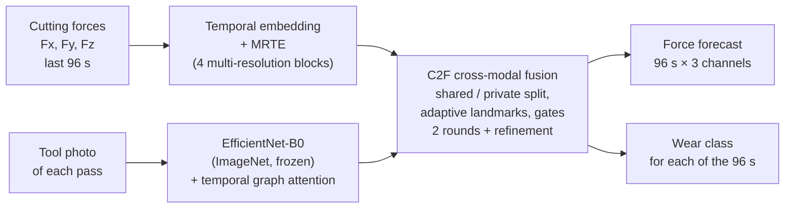
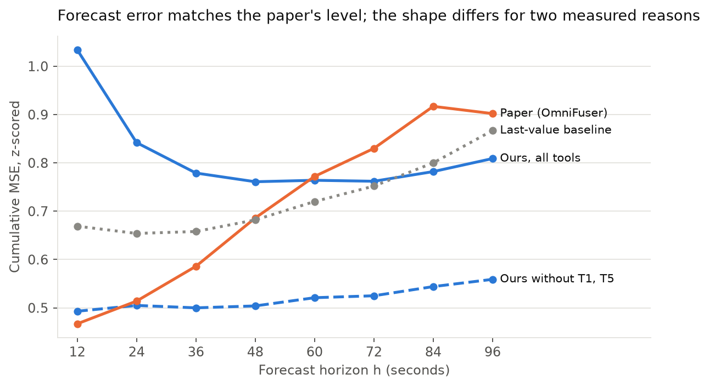
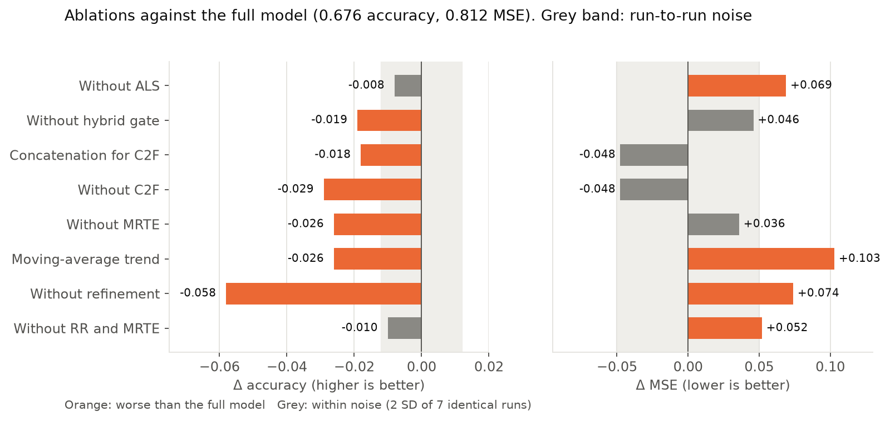
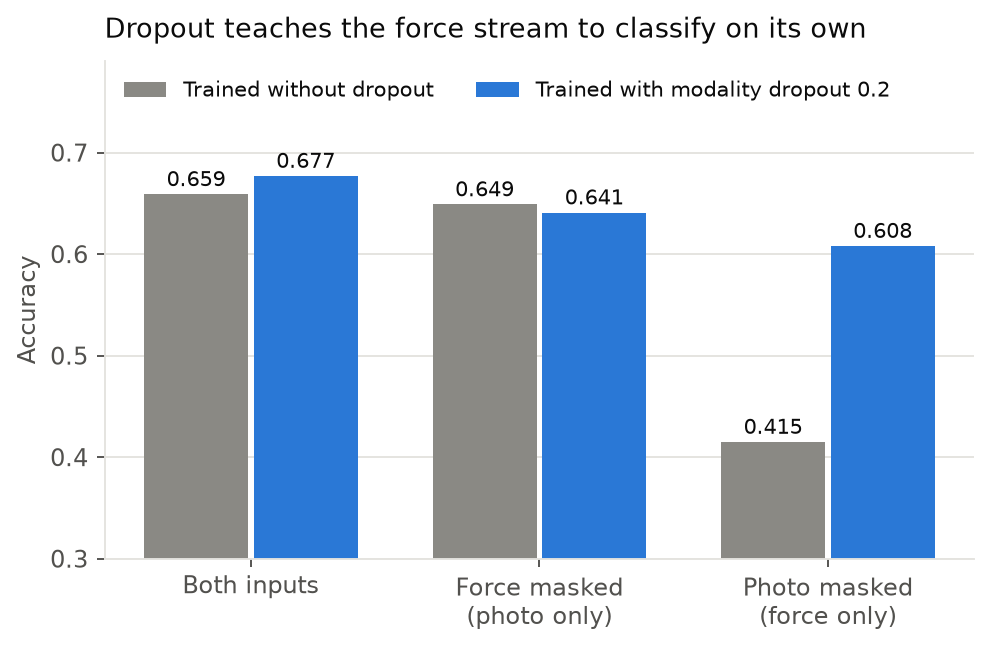
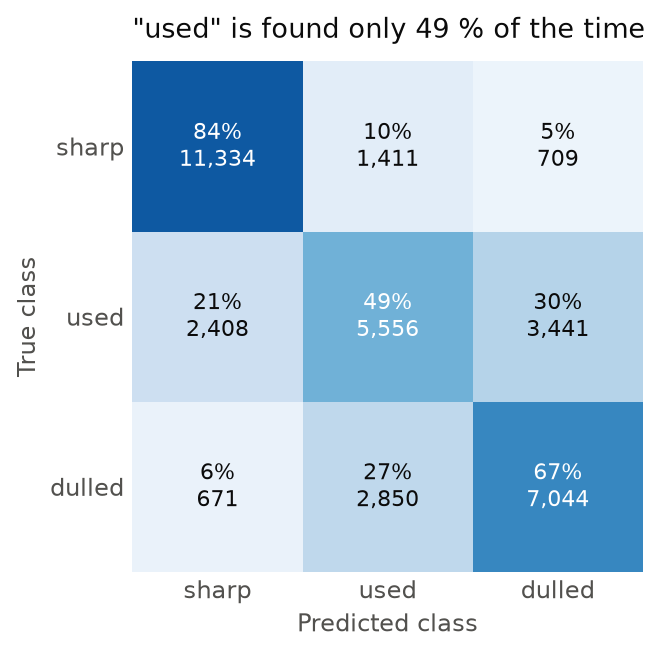
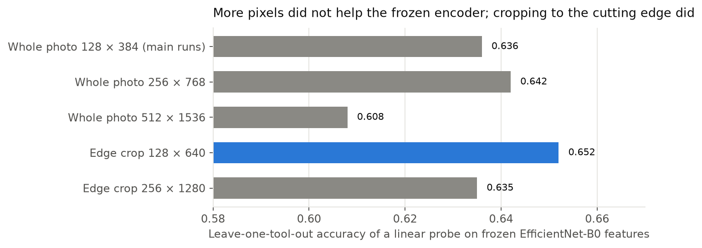
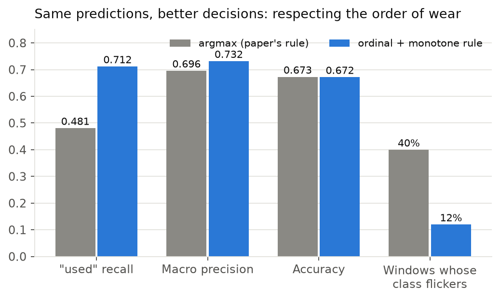
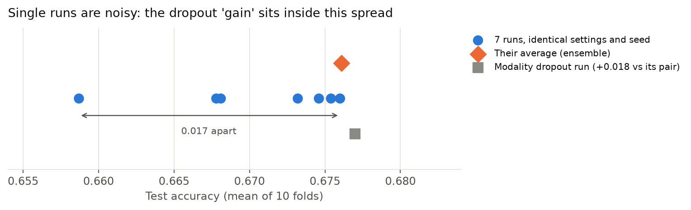

# OmniFuser on Nonastreda: reproducing a multimodal predictive-maintenance model


I rebuilt **OmniFuser** ([arXiv:2511.01320](https://arxiv.org/abs/2511.01320)) from its
paper, in PyTorch. The model fuses **cutting-force signals** with **photos of the cutting
tool** to do two things on a milling machine:

- **forecast** the next 96 seconds of force;
- **classify the tool's wear** (sharp, used, dulled) for each of those seconds.

I trained and evaluated it on the public **Nonastreda** dataset with a deliberately strict
protocol: every result is measured on a tool the model has never seen. I then went beyond
reproducing a number:

- I diagnosed **why** classification falls short of the paper;
- I validated fixes against measured run-to-run noise;
- I turned the architecture into a reusable backbone for a follow-up
  remaining-useful-life (RUL) project.

<table>
<tr>
<td align="center"><b>0.595</b><br/>forecast MAE<br/><sub>paper: 0.597</sub></td>
<td align="center"><b>51</b><br/>complete 10-fold runs<br/><sub>NVIDIA A100, Ruche cluster</sub></td>
<td align="center"><b>180</b><br/>automated tests<br/><sub>ruff + pyright clean</sub></td>
<td align="center"><b>35</b><br/>paper items audited<br/><sub>3 documented deviations</sub></td>
<td align="center"><b>+0.22</b><br/>"used" recall from a<br/>post-hoc decision rule</td>
</tr>
</table>

---

## Contents

1. [The problem and the goals](#1-the-problem-and-the-goals)
2. [How the model works](#2-how-the-model-works)
3. [Protocol: why the test is strict](#3-protocol-why-the-test-is-strict)
4. [Results](#4-results)
5. [Diagnosing the classification gap](#5-diagnosing-the-classification-gap)
6. [What is running now and what comes next](#6-what-is-running-now-and-what-comes-next)
7. [The journey](#7-the-journey)
8. [Mistakes I made and how I fixed them](#8-mistakes-i-made-and-how-i-fixed-them)
9. [Lessons learned](#9-lessons-learned)
10. [Engineering highlights](#10-engineering-highlights)
11. [Repository map](#11-repository-map)
12. [Quick start](#12-quick-start)
13. [Technical reference](#13-technical-reference)

---

## 1. The problem and the goals

A worn cutting tool ruins parts and wastes machine time; replacing tools too early wastes
money. Predictive maintenance aims to know a tool's state, and its near future, from data
the machine already produces.

| Goal | What I set out to do | Status |
|---|---|---|
| **Reproduce** | Implement OmniFuser faithfully, with every equation mapped to code and every gap in the paper filled with a documented, tested choice | Done (v1.0) |
| **Evaluate honestly** | Measure it on unseen tools, against simple baselines, with leakage checks | Done: 51 runs |
| **Explain** | Find out why the results differ from the paper, with measurements rather than guesses | Done |
| **Improve** | Fix what the diagnosis found, validated against run-to-run noise with decision rules fixed in advance | Running on the cluster |
| **Reuse** | Turn the model into a backbone for remaining-useful-life prediction | Done (v1.1) |

**The data (Nonastreda):**

- 10 milling tools, each run from new until well past dulled;
- 512 recorded passes of three-axis cutting force at 1 kHz;
- one photo of the tool after each pass, and a wear label per pass.

134 force recordings are exact copies of another pass. 24 of those groups carry
conflicting labels, so I merge them, which leaves 378 passes ([`EDA.md`](EDA.md)).

## 2. How the model works



- **Two streams, one fused vector.** Both outputs read the same last fused step, so both
  the forecast and the class use both inputs.
- **Size.** 4.18 M parameters. Only 176 k of them train, because the image backbone is
  frozen.
- **Where the paper is ambiguous**, I chose the reading that matches its figures and ran
  the literal reading as a separate experiment, so each choice is tested, not assumed
  ([`PAPER_IMPLEMENTATION_ALIGNMENT.md`](PAPER_IMPLEMENTATION_ALIGNMENT.md)).

## 3. Protocol: why the test is strict

**10-fold leave-one-tool-out cross-validation.** In each fold:

- one tool is the **test tool**, never seen in training or model selection;
- the next tool picks the best epoch;
- the other 8 tools train the model.

The result is reported as the mean over the 10 held-out tools.

This is the realistic factory situation: the model meets a new tool. It is also much harder
than splitting each tool's windows at random. The paper does not state its split, and the
gap between the two is something I am now measuring directly (§6).

## 4. Results

**Forecasting reaches the paper's error level** (mean over the paper's 8 horizons):

| | Forecast MAE | Forecast MSE | Class accuracy | Macro precision |
|---|---|---|---|---|
| This implementation (main run) | **0.595** | 0.817 | 0.674 | 0.695 |
| Paper (OmniFuser) | 0.597 | 0.747 | 0.867 | 0.874 |

<picture>
  <source media="(prefers-color-scheme: dark)" srcset="docs/readme/forecast_horizon-dark.png">
  
</picture>

Our error *falls* with the horizon while the paper's rises. I traced this to two measurable
causes rather than tuning the model:

1. **Windows are phase-locked to the passes.** Test windows start every 96 s and a pass
   lasts about 98 s, so forecasts begin at the jump between passes, the hardest moment to
   time.
2. **Two test tools sit outside the training range.**
   - T1 cuts at a force level 1.15 standard deviations above all training tools.
   - T5 is the most worn tool, with forces 1.5-1.8× more spread out.
   - Without these two tools, the curve rises like the paper's (dashed line).

**Every component helps classification, as in the paper** (ablations, scored on both
tasks):

<picture>
  <source media="(prefers-color-scheme: dark)" srcset="docs/readme/ablations-dark.png">
  
</picture>

- Removing the refinement round costs the most accuracy (−0.058).
- The fusion block (C2F) helps classification but not the forecast. Without it, MSE is
  lower, though within noise.

**Other studies** (51 runs in total):

| Study | Finding |
|---|---|
| Image encoder | ImageNet pretraining is decisive (+0.12 accuracy over training from scratch); fine-tuning and removing the image graph-attention layer both reach about 0.69, the best single runs |
| Image source | A spectrogram of the raw force, with no photo at all, gives the best forecast (MSE 0.749 ≈ the paper's 0.747) |
| Prediction head | My per-lead head beats the paper's literal repeated head: 0.677 against 0.610 accuracy, 0.81 against 0.95 MSE |
| Literal paper equations | Worse than my readings by 0.04-0.07 accuracy, which supports the choices |
| Sensitivity (22 runs) | The paper's values are best or tied on 6 of 8 axes and give the lowest MSE of all 22 runs |
| Duplicates | Keeping the duplicated recordings in training lowers forecast MSE (0.805 → 0.704) without changing accuracy |

<picture>
  <source media="(prefers-color-scheme: dark)" srcset="docs/readme/robustness-dark.png">
  
</picture>

## 5. Diagnosing the classification gap

Accuracy is 0.67 against the paper's 0.87. Instead of tuning until the number moved, I
measured where the errors come from.

<table>
<tr>
<td width="44%">
<picture>
  <source media="(prefers-color-scheme: dark)" srcset="docs/readme/confusion-dark.png">
  
</picture>
</td>
<td>

| Measurement | Value | Meaning |
|---|---|---|
| ROC AUC | **0.87** | The classes are ranked well; the final decisions are not |
| Training vs held-out accuracy | **0.88 → 0.67** | A cross-tool generalization gap, not under-training |
| Photo masked / force masked | 0.43 / 0.65 | The photo carries the class |
| Copying the shown photo's label | **0.95** | The frozen encoder reads the wear in the photo poorly |
| Run number alone | **0.71** | A schedule shortcut that would not transfer |
| Accuracy where the label differs from the photo | **0.43** | The real forecasting case is hard |
| Errors between neighbouring classes | 88 % | The errors are ordinal |

</td>
</tr>
</table>

Each finding led to a check that needed no new training.

**Is the photo too small?** No. I tested this with a linear probe on frozen features,
leaving one tool out:

<picture>
  <source media="(prefers-color-scheme: dark)" srcset="docs/readme/photo_probe-dark.png">
  
</picture>

**Are the decisions throwing information away?** Yes. Two facts fix this without
retraining: wear is ordered (sharp < used < dulled), and it never decreases. A decision
rule that respects both, validated on all 51 runs:

<picture>
  <source media="(prefers-color-scheme: dark)" srcset="docs/readme/decision_rule-dark.png">
  
</picture>

**How big is the noise?** I found that seven of my runs had identical settings and seed.
They differ only by GPU non-determinism:

<picture>
  <source media="(prefers-color-scheme: dark)" srcset="docs/readme/replicates-dark.png">
  
</picture>

That changed how I read every comparison: an apparent +0.018 gain from modality dropout was
noise. Since then, every fix is tested over 5 seeds, paired by fold, with decision rules
written down before the runs.

**Is it label noise?** Partly.

- 31 of 378 passes break the rule that wear never decreases.
- Scoring the same predictions against cleaned labels moves accuracy by only +0.004.
- 84 % of the errors are on consistent labels.

Full analysis: [`FINAL_REPORT_REPRODUCTION.md`](FINAL_REPORT_REPRODUCTION.md) and
[`FIXES_AND_VALIDATION.md`](FIXES_AND_VALIDATION.md).

## 6. What is running now and what comes next

| Experiment | Design | Question |
|---|---|---|
| **Training-side fixes** ([runbook](TRAINING_RUNBOOK_RUCHE_FIXES.md)) | 9 single-change arms × 5 seeds, then the combination; adoption rules fixed in advance | Do these raise accuracy beyond noise: removing the run-number code, per-window normalization (RevIN), an ordinal (CORAL) head, a cutting-edge crop, a fine-tuned encoder? |
| **The split experiment** | The same model with leave-one-tool-out, within-tool time blocks, and random windows; 3 seeds | How much of the gap to the paper's 0.87 is the evaluation protocol rather than the model? |
| **OmniFuser-RUL** | v1.1's `encode()` with an RUL head, used as a baseline in a separate RUL project with causal labels and photo availability | Which modality carries remaining-life information, and are two modalities justified or is one enough? |

## 7. The journey

| Date (2026) | Phase | What happened |
|---|---|---|
| Oct 11 | **Build and audit** | Implemented the model from the paper, block by block, checking each against its equation; added the paper's ablations and sensitivity axes as flags |
| Oct 14-15 | **Data first** | Exploratory analysis: duplicate recordings with conflicting labels, pass trimming, the time step that matches the paper's difficulty; first training runbook (Lightning AI) |
| Oct 18 | **Protocol decision** | Adopted the paper's same-pass photo; kept the previous-pass photo as a leakage experiment; pretrained, frozen image encoder |
| Oct 19-22 | **Scale to a cluster** | Moved to the Ruche HPC cluster: SLURM jobs, chained 24-hour jobs, interruption-safe saves; added a spectrogram study; a review before the big runs caught two silent bugs, both now guarded by tests |
| Oct 26-29 | **Train** | Saved every fold as a portable model file; ran 51 complete 10-fold studies on A100 GPUs |
| Oct 30 | **Explain** | Diagnosed the classification gap; validated post-hoc decision rules on all runs; discovered the run-to-run noise floor |
| Nov 3 | **Question the protocol** | Measured label noise; built the split experiment; prepared a seeded, pre-registered study of the fixes |
| Nov 5 | **Reuse** | Released v1.1 (`encode()`, outputs bit-identical to v1.0 in 48 configurations); built OmniFuser-RUL as a baseline in a new RUL project |

**How my approach evolved:**

| Then | Now |
|---|---|
| "Reproduce the paper's number" | "Explain why my number differs, with measurements" |
| One run per configuration | Seeds, paired tests, decision rules written before the results |
| Local CPU experiments | Resumable SLURM jobs on an A100 cluster |
| Trusting a strong input | Checking every input against simple baselines for leakage and shortcuts |
| Implementing a model | Designing a follow-up study around it |

## 8. Mistakes I made and how I fixed them

| What I got wrong | How I found out | What I changed |
|---|---|---|
| Read a single-run gain (+0.018 from modality dropout) as an effect | Found 7 runs with identical settings spread over 0.017 | 5 seeds per arm, paired fold-by-fold tests, rules fixed in advance |
| Assumed the classification gap was under-training | Training accuracy was 0.88 and the best epochs came early | Diagnosed a cross-tool gap; the fixes now target tool shift and shortcuts |
| Expected higher-resolution photos to fix photo reading | My probe: near-native resolution scored *worse* (0.608 vs 0.636) | A crop of the cutting edge instead; fine-tuning as the real lever |
| Treated the paper's same-pass photo as a fair input | Copying that photo's label already scores 0.95 | Report persistence and the accuracy where the label changes (0.43) next to every result |
| A "frozen" backbone still ran stochastic depth in training mode, so a photo's features changed from batch to batch | A code review before the cluster runs | The frozen trunk is forced into evaluation mode and its features are cached once per fold; a test now checks that cached and live features match |
| Combined two decision rules naively (a running maximum) | It lowered accuracy in 35 of 51 runs | A principled rule (the non-decreasing sequence with the smallest expected class distance); the selection step is disclosed |
| A first easier-split design dropped 45 % of the training windows, which biased the comparison | Counted the windows on the real data | Time-adjacent training blocks are joined (1,078-1,155 windows against 1,127-1,213) |
| Finished fits were never reused after an interruption (RUL baseline) | A resumption test | Settings compared in JSON form; regression tests added |

## 9. Lessons learned

1. **The protocol matters more than the architecture.** Leave-one-tool-out exposed a 0.21
   generalization gap that random splits would likely hide (the split experiment of §6
   measures by how much).
2. **Measure the noise before claiming an effect.** Identical runs differ by 0.017,
   about the size of most effects I was comparing.
3. **Simple baselines find leakage and shortcuts.** Copying the photo's label (0.95) and
   predicting from the run number (0.71) said more about the task than any ablation.
4. **Good ranking is not good decisions.** A ROC AUC of 0.87 became 0.67 accuracy until
   the decision rule respected the order of wear.
5. **Tests are measuring instruments.** Equivalence tests now guard against the silent
   bugs a review found, and a bit-identical comparison proved a refactor safe.
6. **Write the decision rule before the result.** Pre-declared rules keep the results from
   choosing their own criteria.
7. **Design for interruption on a cluster.** Atomic saves, signature-checked fold reuse
   and resumable jobs turned the 24-hour time limits into a non-issue.

## 10. Engineering highlights

- **180 tests.** They cover:
  - numerical equivalence (cached against live features, a NumPy reference of the front
    end);
  - leakage (no test-tool statistic reaches training);
  - competence (the model can memorize a batch and learn an image-only class);
  - interruption and resume, and saved-model round trips.
- **Reproducible runs:**
  - each fold records a data signature and the full configuration;
  - finished folds are reused only when everything matches;
  - writes are atomic, so a killed job never leaves a fold that looks finished.
- **Portable models.** Every fold saves `fold-Tn.pt`, holding its weights, configuration,
  normalizer and data settings. `omnifuser predict` reuses one without training.
- **Cluster tooling.** SLURM job, chain and status scripts, with runbooks written for
  first-time cluster users.
- **Clean code.** Ruff and pyright report no issues; every option is a flag that defaults
  to the paper or the protocol.
- **Reusable backbone (v1.1).** `encode()` exposes the fused representation for new
  heads.

## 11. Repository map

| Document | Read it for |
|---|---|
| [`FINAL_REPORT_REPRODUCTION.md`](FINAL_REPORT_REPRODUCTION.md) | **The results**: all 51 runs, the classification diagnosis, why the error curve differs from the paper's |
| [`FIXES_AND_VALIDATION.md`](FIXES_AND_VALIDATION.md) | The fixes, how each was validated, and their status |
| [`EDA.md`](EDA.md) | The data: passes, labels, duplicates, alignment, leakage |
| [`PAPER_IMPLEMENTATION_ALIGNMENT.md`](PAPER_IMPLEMENTATION_ALIGNMENT.md) | Paper versus code: 35 items, deviations and the paper's own inconsistencies |
| [`END_TO_END_SIM.md`](END_TO_END_SIM.md) | How it works: every function from raw files to results, with real numbers |
| [`RESULTS_MAIN_RUNS.md`](RESULTS_MAIN_RUNS.md) | First results of the two main runs, by horizon and lead |
| [`FUTURE_WORK_AND_ANALYSIS.md`](FUTURE_WORK_AND_ANALYSIS.md) | A critical review and the roadmap toward a multimodal foundation model |
| [`TRAINING_RUNBOOK.md`](TRAINING_RUNBOOK.md), [`TRAINING_RUNBOOK_RUCHE.md`](TRAINING_RUNBOOK_RUCHE.md), [`TRAINING_RUNBOOK_RUCHE_FIXES.md`](TRAINING_RUNBOOK_RUCHE_FIXES.md) | Every command, on Lightning AI and on the Ruche cluster |
| [`experiment_results/README.md`](experiment_results/README.md) | Layout of the generated results |

```text
omnifuser/            the package: config, data, models, train, evaluation, cross_validation,
                      tracking, cli, model_bundle (saved models, predict), decision (post-hoc
                      decision rules), resources, spectrogram (optional image source)
scripts/              train_lightning.py (10-fold CV), run_experiment_suite.py (studies),
                      train_local.py, eda.py, compare_with_paper.py, model_summary.py,
                      end_to_end_trace.py, readme_figures.py; analysis of finished runs:
                      decision_study.py, ensemble_runs.py, fixes_analysis.py,
                      split_study.py, window_diagnostics.py, phase_study.py, photo_probe.py
docs/                 figures of END_TO_END_SIM.md and of this README
slurm/                Ruche job scripts: job.sbatch, checks.sbatch, chain.sh, env.sh,
                      protocol.sh, status.sh
tests/                180 pytest tests
experiment_results/   generated outputs (git-ignored except its README)
```

## 12. Quick start

Python 3.10 or newer. The data (Nonastreda) goes in `Nonastreda_Data/` and is not in the
repository.

```bash
python -m venv .venv
source .venv/bin/activate                      # Windows: .\.venv\Scripts\Activate.ps1
python -m pip install -e ".[test,eda]"         # add ,dev for ruff and pyright

python -m pytest -o addopts= -q tests          # 180 tests
omnifuser inspect --data-dir Nonastreda_Data --pool 1000 --stride 24
python scripts/train_local.py --data-dir Nonastreda_Data --image-encoder compact \
  --pool 1000 --image-lag 0 --stride 24        # one capped fold on the CPU
```

- **Reuse a trained fold without training:** `omnifuser predict --model <run>/fold-T10.pt
  --data-dir Nonastreda_Data --tool T10 --output-dir <folder>`.
- **Full training:** [`TRAINING_RUNBOOK.md`](TRAINING_RUNBOOK.md) (Lightning AI) or
  [`TRAINING_RUNBOOK_RUCHE.md`](TRAINING_RUNBOOK_RUCHE.md) (a SLURM cluster).

**Use OmniFuser as a backbone (v1.1):**

```python
from omnifuser.config import ModelConfig
from omnifuser.models import OmniFuser

model = OmniFuser(ModelConfig(image_views=2))        # 2 photo views per step, precomputed
fused = model.encode(force, photo_features, photo_indices)   # (batch, 96, 32)
my_output = my_head(fused[:, -1])                    # any head on the last fused step
```

`forward()` is `encode()` followed by the original heads, with outputs bit-identical to
v1.0.

## 13. Technical reference

<details>
<summary><b>Data pipeline and evaluation</b></summary>

**Data**, in five steps:

1. **Merge duplicate passes.** Identical force recordings are merged, keeping the most-worn
   annotation: 512 rows become 378 passes.
2. **Trim each pass.** The entry and exit transients are removed.
3. **Pool to 1 s steps.** `--pool 1000` averages 1,000 samples into one step.
4. **Concatenate per tool.** Each step carries its pass's label and photo
   (`--image-lag 0`, the paper's association; `--image-lag 1` shows the previous pass's
   photo instead).
5. **Window.** 96 input steps followed by 96 forecast steps.

**Evaluation:**

- 10-fold leave-one-tool-out, with three input modes per fold: both inputs, force masked,
  photo masked.
- Accuracy and macro/weighted precision, recall, F1 and ROC AUC.
- MAE, MSE and RMSE, in newtons and z-scored, per channel and per forecast step.
- The paper's 8 horizons, next to persistence and last-value baselines.

</details>

<details>
<summary><b>Defaults: library versus experiment protocol</b></summary>

| Setting | `omnifuser train`, `train_lightning.py` | Protocol (runbook, `run_experiment_suite.py`) | Why |
|---|---|---|---|
| Time step `--pool` | 1 (1 ms) | 1000 (1 s) | Only 1 s steps match the paper's difficulty (`EDA.md` §6) |
| Photo `--image-lag` | 0 (same pass, paper) | 0; 1 is an experimental run | The paper's association; lag 1 measures its leakage |
| Image encoder `--pretrained`, `--freeze-image-encoder` | off | on: ImageNet weights, frozen | Stable photo features from only 8 training tools |
| Image source `--image-source` | `photo` | `photo`; spectrograms are an experiment | The paper uses tool photos |
| Horizon / input | 96 / 96 | 96 / 96 | The paper's horizons go up to 96 |
| Training stride | 192 | 24 | More training windows at 1 s steps |
| Duplicates `--dedup-identical-forces` | True (378 passes) | True (step 3b: False) | 134 exact copies, 24 groups with conflicting labels |
| Epochs | 5 | 30 | The paper gives no epoch count |
| Optimizer | Adam, lr 1e-4, batch 32, dropout 0.1 | same | The paper's values |
| Architecture | d=32, L=4, s_l=3, r=8, GAT 4×4, k=4, n=2 | same | The paper's values |
| Head / ALS / private path | `direct` / `k_colnorm` / `plain` | same | Closest usable reading of Eqs. 21-22, 10, and Sec. V-C |

</details>

<details>
<summary><b>Departures from the printed paper, and the flags that restore it</b></summary>

| Default | Restore the printed version with | Reason |
|---|---|---|
| Fig. 5's trend and seasonal branches | `--decomp-mode literal` | Printed Eq. 3 cancels to the identity |
| Per-lead head | `--prediction-head paper_literal` | The printed head predicts one value for all 96 leads |
| Normalized landmark scale | `--als-mode k_sum` | Printed landmarks grow with input length |

</details>

<details>
<summary><b>Options added after the main runs (all default to the protocol)</b></summary>

| Flag | Effect |
|---|---|
| `--metadata {all,position,none}` | Keep or drop the run, block and position codes (the run number is a shortcut) |
| `--revin` | Normalize each input window by its own level and spread, and map the forecast back |
| `--class-loss coral` | Ordinal head: two ordered thresholds (sharp < used < dulled) instead of a 3-class softmax |
| `--image-crop T L B R`, `--image-size H W` | Crop each photo (e.g. to the cutting edge) before resizing |
| `--split {tool,block,window}` | Leave one tool out (the protocol), or two easier experiments: within-tool time blocks, random windows |
| `omnifuser predict --evaluation-stride N` | Re-score a saved model with windows every N steps |
| `ModelConfig(image_views=V)` | V photo views per step, as precomputed features (v1.1) |

</details>

<details>
<summary><b>Development checks, status and limitations</b></summary>

```bash
python -m pytest -o addopts= -q tests    # 180 passed
ruff check .                             # all checks passed
pyright                                  # 0 errors (config in pyproject.toml)
```

- **Verified on the CPU** (2026-10-14): every entry point, ablation and flag, on the real
  data with capped windows.
- **Trained on the GPU** (2026-10-28/29): 51 complete 10-fold runs on the Ruche cluster
  (NVIDIA A100).
- **Not implemented:** the paper's comparison models (its Tables IV-V baselines), its
  image-update-frequency experiment, and a FLOPs study beyond parameter counts.
- **The paper's numbers** come from "Mudestreda", which is built on the same data, but the
  paper does not state its time step, alignment or split. They are a reference, not a
  like-for-like target.
- `train_lightning.py` is plain PyTorch; it runs in a Lightning AI Studio but does not use
  the Lightning `Trainer`.

</details>

---

*The figures are generated by [`scripts/readme_figures.py`](scripts/readme_figures.py) from
the numbers in the reports. Questions and feedback are welcome through the repository's
issues.*
